# QUANTA Equity Research

A research workstation for US and Indian equities. A local Flask web app (Overview, Discover,
Research, Picks, My Portfolio) sits on multi-factor screening, risk-first position sizing and
walk-forward validation engines, and tells you, next to every call, what is known about the model
behind it.

[](https://github.com/AtreshSoma/quanta-equity-research/actions/workflows/ci.yml)
[](https://www.python.org/)
[](#code-style)
[](LICENSE)

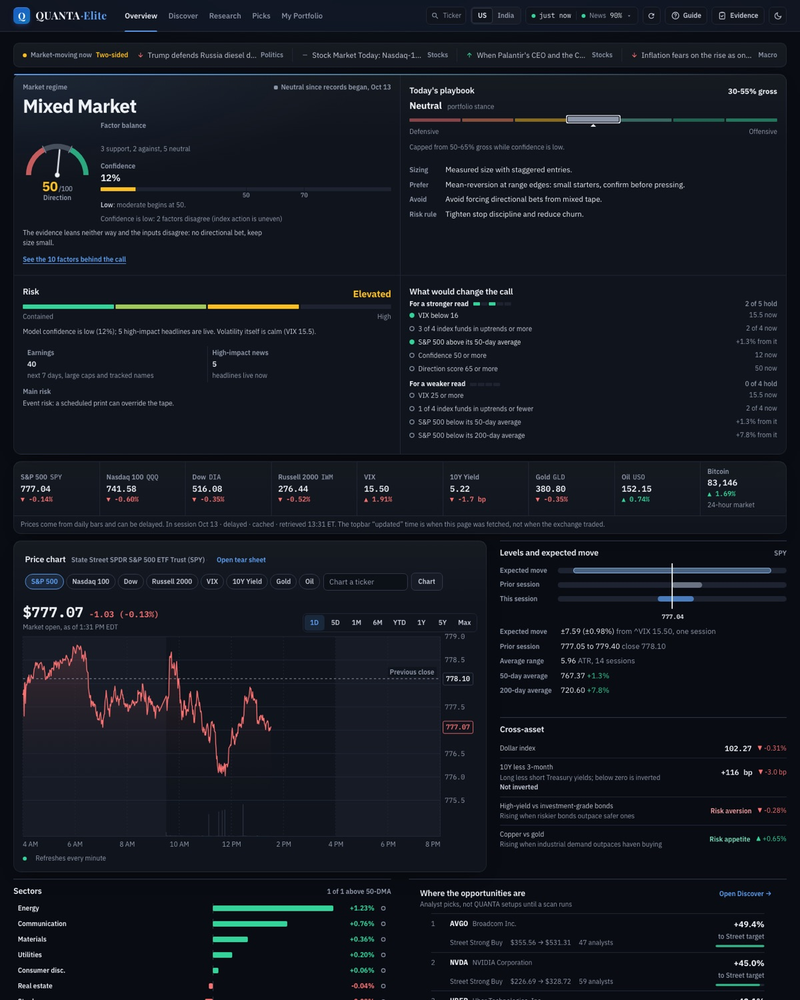

> **Educational software, released under the [MIT License](LICENSE).** This is not financial advice,
> and no strategy here has a demonstrated out-of-sample edge. See
> [Licence and disclaimer](#licence-and-disclaimer) before you act on anything it prints.

The [QUANTA Alpha audit and build blueprint](docs/audits/QUANTA-ALPHA/README.md) is a dated design
reference. The [current validation status](docs/LIVE_MODEL_VALIDATION_STATUS.md) describes the live
model and the limits of its evidence. All other design notes, audits and logs are indexed in
[docs/README.md](docs/README.md).

---

## Contents

| Section | What you'll find |
|---|---|
| [At a glance](#at-a-glance) | What it is, what it is not, and how the parts fit |
| [Quick start](#quick-start) | Install, start the web app, or produce a CLI report |
| [The web app](#the-web-app) | Each page, how calls are labelled, and the rules behind them |
| [How a Decision is made](#how-a-decision-is-made) | The flow from data to a labelled call |
| [Track record](#track-record) | How calls are recorded, scored and made tamper-evident |
| [What's in the box](#whats-in-the-box) | The four engines and when to reach for each |
| [The short-term scanner](#the-short-term-scanner) | Primary CLI, flags, and how to read its output |
| [Validation harness](#validation-harness) | Walk-forward testing, leakage and cost guards |
| [Performance](#performance) | What is measured, what is in place, and what bounds a cold start |
| [Project layout](#project-layout) | Directory map |
| [Configuration](#configuration) | Environment variables and engine knobs |
| [Testing](#testing) | The four suites and how to run each |
| [Development](#development) | Code style, CI, contributing |
| [Troubleshooting](#troubleshooting) | Common failures and their causes |
| [Known limitations](#known-limitations) | What this does *not* do |

---

## At a glance

| It is | It is not |
|---|---|
| A local research tool: it runs on your computer, on loopback only | A hosted service or a trading bot; it places no orders |
| Honest about evidence: every call carries a flag saying whether its model was tested out of sample | A source of validated signals: **no model here has a demonstrated edge** |
| Risk-first: sizes are a risk budget, stops are ATR-based, and a call is refused when its reward-to-risk fails | A promise of returns; a high win rate with no excess return is the trap its tests exist to catch |
| Free-data by default: Yahoo Finance via `yfinance`, no API key | Real-time: intraday bars are about 15 minutes delayed |

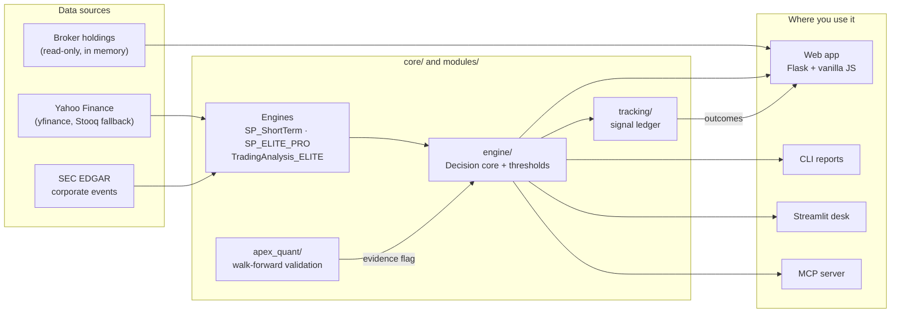

Every surface renders **one** `Decision` object per ticker, built as the engine's last step, so the
web app, the CLI, Streamlit, the MCP server and the ledger can never disagree about a verdict.

---

## Quick start

### Requirements

- **Python 3.11+** (CI runs 3.12)
- **Node.js 20+** only to run the web app's JavaScript tests (CI runs 22)
- No API keys needed for the default path: market data comes from Yahoo Finance via `yfinance`

### Install

```bash
git clone https://github.com/AtreshSoma/quanta-equity-research.git
cd quanta-equity-research

python -m venv .venv
source .venv/bin/activate        # Windows: .venv\Scripts\activate

pip install -e ".[dev,webapp]"
```

`pyproject.toml` and `webapp/requirements.txt` state the version ranges the code supports.
`webapp/constraints.txt` pins the exact set the test suites pass on; `start.ps1` and `start.sh`
install with it. To reproduce a known-good environment by hand:

```bash
pip install -e ".[dev,webapp]" -c webapp/constraints.txt
```

To move to newer releases, upgrade, run the Python and JavaScript suites, then update the pins.

### Start the web app

```bash
./start.sh                       # macOS / Linux: creates .venv, installs what is missing, opens http://127.0.0.1:5500
```

```powershell
.\start.ps1                      # Windows: the same, from PowerShell
```

No terminal needed: double-click **`Start QUANTA.command`** in Finder (macOS; drag it to the Dock
for one-click launches) or **`launch_quanta.bat`** (Windows). Close the window to stop the server.

Before the first scan, copy `.env.example` to `.env` and set `QUANTA_SEC_CONTACT` to your email
address. SEC EDGAR requires it, and without it the corporate-event check fails closed and **no
Picks name can be funded**. `--port 5600` (or `QUANTA_PORT`) serves on another port.

### Build a track record (recommended)

The ledger only proves anything if calls are recorded every day and scored when their horizon
ends. One command schedules that on macOS (Monday to Saturday at 17:30 local time; the job scans
each completed New York session exactly once, so any local time zone works):

```bash
scripts/schedule_daily.sh          # install;  --status to check, --remove to uninstall
scripts/quanta_daily.sh            # or run the job once by hand
```

launchd cannot read a checkout under `~/Documents`, `~/Desktop` or `~/Downloads` unless `/bin/bash`
has Full Disk Access (macOS privacy protection); a checkout elsewhere needs nothing. How the record
is kept, and checked, is under [Track record](#track-record).

### Run your first CLI scan

```bash
python core/SP_ShortTerm.py --capital 25000 --scan standard --max-positions 5 -y
```

That scans 250 of the ~569-name universe and prints a 12-section research plan with
entry and risk references. Roughly 4–6 minutes; the request throttle is deliberate (see
[Troubleshooting](#troubleshooting)).

<details>
<summary><strong>Sample output</strong> (click to expand)</summary>

```
──────────────────────────────────────────────────────────────────────────────
 1.  AT A GLANCE
──────────────────────────────────────────────────────────────────────────────
   • 5 positions to open: MU, FTNT, CVX, CF, VEEV
   • Deploy $6,916.62 of $25,000.00 (27.7%); keep $18,083.38 in cash
   • Total risk if every stop is hit: $549.94 (2.20%) against a 6% budget
   • Lead idea: MU, buy $950.00, stop $833.57, first target $1,254.81 (2.6:1)
   • Horizon: 12 sessions (~2026-09-17); close everything by 2026-10-05

──────────────────────────────────────────────────────────────────────────────
 4.  TRADE LEVELS
──────────────────────────────────────────────────────────────────────────────
Ticker   Buy Limit  Entry Zone       Stop              Target 1 (take 50%)
-------  ---------  ---------------  ----------------  -----------------------
MU       $950.00    $929.62–$987.84  $833.57 (-12.3%)  $1,254.81 (+32.1% 2.6R)
FTNT     $169.88    $167.43–$174.43  $155.90 (-8.2%)   $198.37 (+16.8% 2.0R)
```

</details>

### Other entry points

```bash
python core/SP_ELITE_PRO.py                  # conversational multi-factor engine
python core/TradingAnalysis_ELITE.py         # institutional analysis platform
streamlit run core/streamlit_app.py          # browser research desk
python -m core.apex_quant.run status         # walk-forward sizing verdict
```

```bash
python -m tracking resolve | report | alerts | publish | verify   # from core/: the track-record CLI
```

---

## The web app

`webapp/` is a Flask server (`app.py`) with a vanilla-JavaScript front end (`static/`) and a single
Jinja template. It imports the engines in-process, serves on loopback only (it refuses any other
host), and has no build step.

| Page | What it does |
|---|---|
| **Overview** | Market mood, a session quote board, a plain-English read of the day and an interactive price chart, for the US or India |
| **Discover** | Ranked ideas and the names moving today, each labelled by the model's Decision, with filters for sector and near earnings |
| **Research** | One-ticker tear sheet: decision and levels, live chart, colour-coded technical signals, valuation, peers and risks; searchable US and Indian listings |
| **Picks** | Runs a scan through the engine's gates and lists Buy / Accumulate / Watchlist calls sized to your capital, with the rules each name passed or failed |
| **My Portfolio** | Read-only Robinhood holdings with guidance, intraday, what-if, an Activity ledger and a Review tab. Every performance chart is a replay of today's holdings, not the account's own return |
| **Evidence** | Whether each model is validated out of sample, in plain language, and how published Decisions did |
| **Guide** | Live demonstrations of the rules the engine applies |

<table>
  <tr>
    <td width="50%">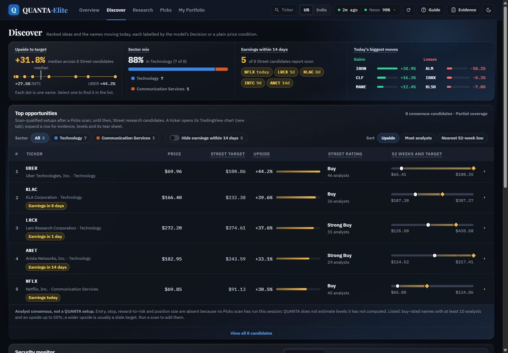<br><sub><b>Discover</b>: ranked Street candidates with upside, sector mix and earnings in view</sub></td>
    <td width="50%">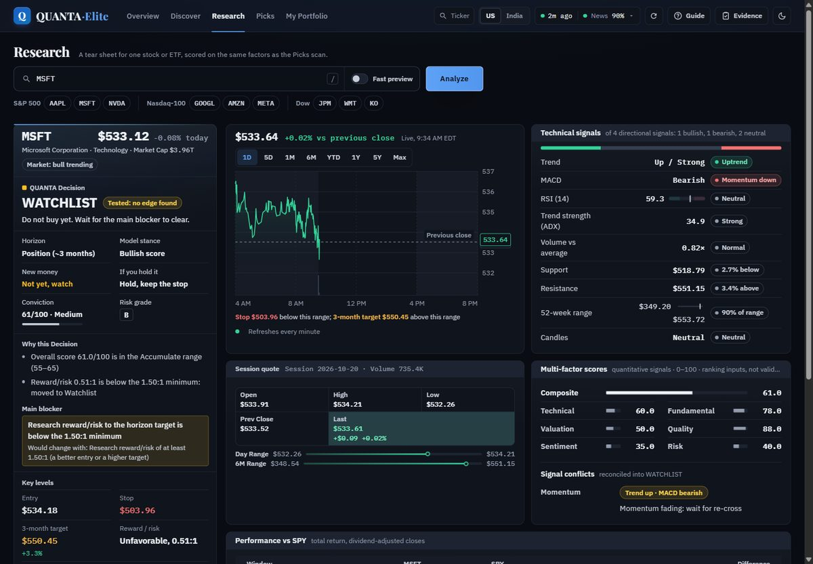<br><sub><b>Research</b>: one Decision, its blocker, key levels and the signals behind it</sub></td>
  </tr>
  <tr>
    <td width="50%">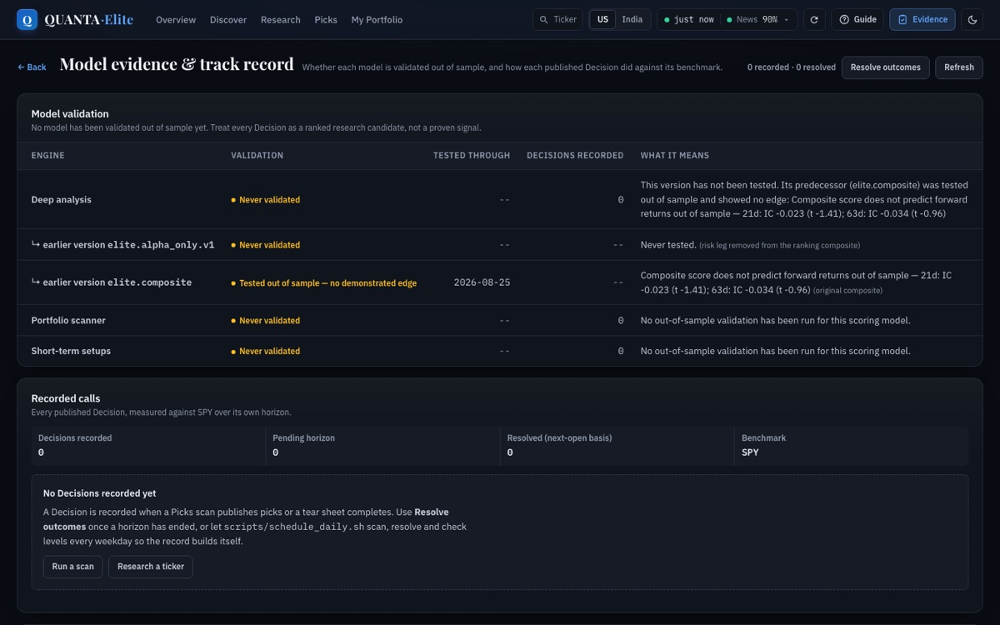<br><sub><b>Evidence</b>: what each model has and has not shown out of sample</sub></td>
    <td width="50%">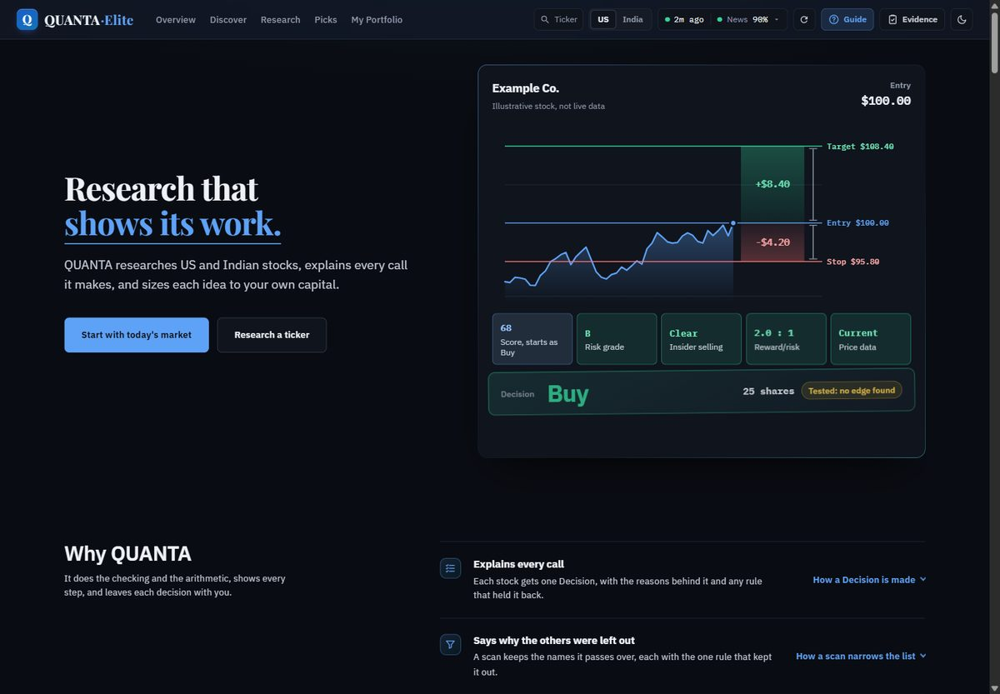<br><sub><b>Guide</b>: a worked example of how a call is built</sub></td>
  </tr>
</table>

<table>
  <tr>
    <td>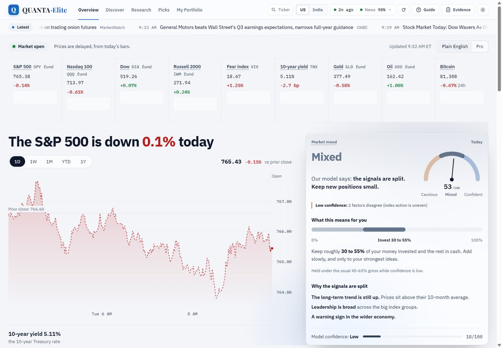<br><sub>Light and dark follow your system setting, or the toggle in the top bar</sub></td>
    <td>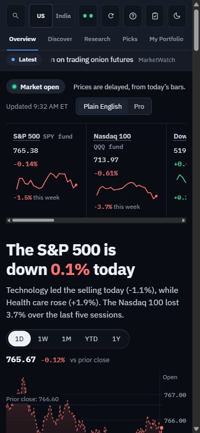<br><sub>Phone width: no horizontal scroll</sub></td>
  </tr>
</table>

Decision thresholds have one source, `core/engine/thresholds.py`; the front end reads an exported
copy (`webapp/tests/fixtures/thresholds.json`), and a test fails if the two drift.

### How calls are labelled

Calls keep their plain names (Buy, Accumulate, Watchlist), and each one carries a flag that states
what is known about the model behind it:

| Flag | Meaning |
|---|---|
| **Tested: no edge found** | The model was tested out of sample and showed no reliable predictive power |
| **Model not yet validated** | The model has not been tested, or its test is out of date |
| *(no flag)* | The model passed out-of-sample validation (none does today) |

The Picks scanner has no test of its own. Every Buy or Accumulate it publishes must first pass the
Research model, so Picks shows the Research model's result. Sizes are a risk budget, not advice to
buy, and each call is accompanied by a not-advice line.

### Decision rules

The values below are the current defaults in `core/engine/thresholds.py`.

| Rule | Value |
|---|---|
| Reward-to-risk a Buy or Accumulate must clear, on its published entry, stop and target, net of costs | 1.8 |
| Reward-to-risk label line used by the Research engine on its own | 1.5 |
| Stop distance, both engines (extended under support when support sits within one ATR) | 2.75 x ATR |
| Largest loss a forced single share may carry, as a share of the account | 1% |
| Picks deployment ceiling | The top of the Overview exposure band in force |
| Oldest accepted daily bar for a scan | 3 trading sessions |
| Discover analyst list | At least 10 analysts and no more than 50% upside to the consensus target |

Insider buying never relaxes the reward-to-risk rule. India listings are charged the statutory
levies (about 24 bps round trip) on top of spread and slippage.

---

## How a Decision is made

Every Research page and every Picks call ends the same way. A name that fails a gate does not
disappear: it is kept as a Watchlist call that names the rule that held it back and the condition
that would clear it.

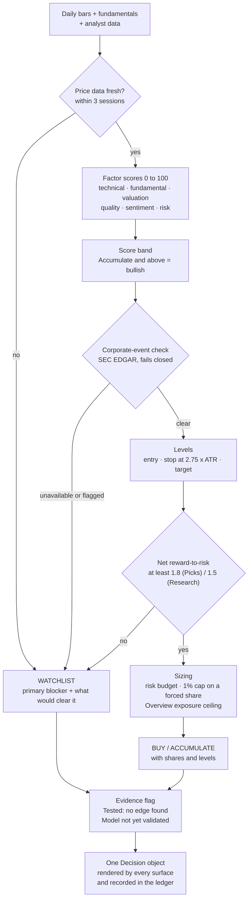

The diagram simplifies the order; `core/engine/decision.py` and `core/engine/blockers.py` are the
authority, and every blocker carries a stable code, a category and the condition that clears it.

The Picks scan wraps that path in a funnel across the whole universe:

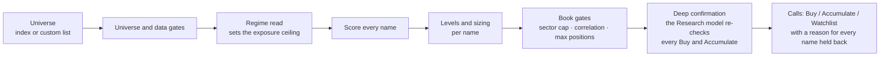

---

## Track record

The ledger only proves anything if it is built to be checked, not trusted:

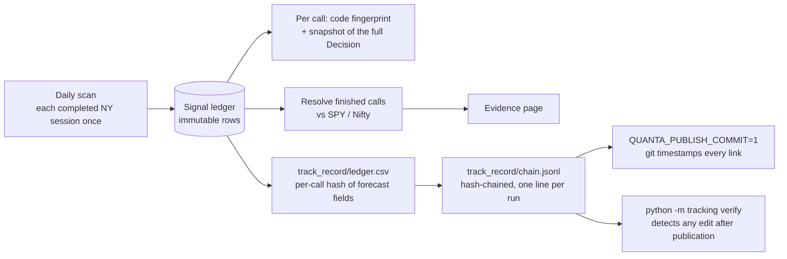

- Every call stores the **fingerprint of the engine code** that produced it and a snapshot of the
  full Decision behind it, so a period can be shown to have run on frozen code and any call can be
  replayed. The Evidence page shows how many calls the current code made.
- The fingerprint hashes the raw bytes of `core/engine/*.py`, `SP_ShortTerm.py`,
  `TradingAnalysis_ELITE.py`, `SP_ELITE_PRO.py` and the evidence registry. **Editing any of those,
  even a comment, starts a new fingerprint period.** Documentation moves must not touch them.
- Each run exports `track_record/ledger.csv` with a per-call hash of the forecast fields and
  appends a hash-chained line to `track_record/chain.jsonl`. Set `QUANTA_PUBLISH_COMMIT=1` to
  commit it daily, so git timestamps every link. `python -m tracking verify` (from `core/`) detects
  any forecast or link edited after publication.
- The daily job also posts a notification for any stop or target an open call touched, and logs
  the benchmarked report to `logs/daily/`. The **Resolve outcomes** button on the Evidence page
  does the resolving step for unscheduled use.

---

## What's in the box

Four engines share the `core/` tree. They are **independent**: pick the one that matches your
question.

| Engine | File | Use it when you want |
|---|---|---|
| **Short-term scanner** | `core/SP_ShortTerm.py` | Swing-trade setups with concrete entry/stop/target levels and dated horizons. **Start here.** |
| **QUANTA Elite Pro** | `core/SP_ELITE_PRO.py` | The engine behind web Picks: a conversational, profile-aware screen with narrative recommendations |
| **Trading Analysis Elite** | `core/TradingAnalysis_ELITE.py` | Deep single-name analysis (it powers Research): news sentiment, catalysts, compliance, portfolio risk |
| **Alpha Picks Engine** | `core/Alpha_Picks_Engine.py` | High-conviction screening weighted toward analyst ratings and fundamentals |

Supporting subsystems:

- **`core/engine/`**: the shared decision core (gates, thresholds, blockers, levels, sizing,
  market calendars, corporate events, valuation)
- **`core/apex_quant/`**: walk-forward validation harness with explicit leakage, cost-model and
  reproducibility guards
- **`core/portfolio/`** and **`core/brokers/`**: read-only broker holdings, history, guidance and insights
- **`core/tracking/`**: the signal ledger, fingerprints, alerts and the publish and verify CLI
- **`core/sp_shortterm_backtest.py`**: point-in-time replay of the scanner's technical core
- **`modules/`**: 20 shared services: catalyst intelligence, SEC EDGAR parsing, portfolio risk,
  data-quality validation, provider adapters
- **`mcp_server/`**: Model Context Protocol server exposing the engine to LLM clients

---

## The short-term scanner

`core/SP_ShortTerm.py` is the most actively maintained engine and the one with the richest output.

### How it works

```
Universe (569 names)          S&P 500 + NASDAQ-100 + curated momentum list
        ↓
Liquidity & price gates       min $10M/day dollar volume, $5–$3000, 100+ bars
        ↓
Technical scoring             Wilder RSI / ATR / ADX, MACD, Bollinger, OBV, patterns
        ↓
Price-only pre-screen         skips the expensive fundamentals fetch when the
                              best case still can't clear the threshold
        ↓
Composite score (0–100)       technical 28% · momentum 22% · fundamental 20%
                              quality 12% · sentiment 10% · pattern 8%
        ↓
Regime adjustment             SPY trend + VIX → score multiplier
        ↓
Risk-first sizing             1.5% per trade (2.5% high conviction), 6% portfolio
        ↓
Portfolio construction        max 2 per sector, correlation gate at 0.78
        ↓
12-section report             levels, dated timing, factor grades, tickets
```

### CLI reference

```
python core/SP_ShortTerm.py [options]

  --capital FLOAT              Trading capital in USD (default 2500, floor 500)
  --scan {quick,standard,comprehensive,full}
                               75 / 250 / 400 / entire universe (default standard)
  --max-positions N            Most positions sized at once, 1–10 (default 5)
  --fractional                 Allow decimal share quantities
  --whole-shares               Force whole-share accounting (default)
  --export / --no-export       Write JSON + CSV + Markdown without prompting
  --output-dir DIR             Where exports land (default: current directory)
  -y, --yes                    Non-interactive; use defaults for anything not given
```

With **no arguments** it runs interactively and prompts for each setting, so existing habits still
work.

### Reading the report

| Section | Answers |
|---|---|
| 1. At a glance | The whole report in five lines |
| 2. Market context | What regime these picks were found in |
| 3. The picks | Overview table with signal, quant rating, score, RS |
| 4. Trade levels | **Entry, stop, and three targets** with % and R-multiples |
| 5. Timing | **When each target is due**, as real dates |
| 6. Factor grades | A+..F percentile rank against sector peers |
| 7. Execution tickets | Per-position orders, thesis, risks, step-by-step instructions |
| 8. Supporting data | The raw readings behind the scores |
| 9. Portfolio | Aggregate exposure, watchlist, PM review |
| 10. Intraday refinement | Optional 5-minute entry timing |
| 11. Action plan | What to do, in order |
| 12. How to read this report | Legend for every symbol used |

**Key concepts:**

- **R**: one unit of the trade's own risk (entry − stop). A 2R target pays twice what you risk.
  `+14%` means something different on a name stopped 4% away than one stopped 12% away.
- **R/R**: reward-to-risk to Target 1, **net** of a modelled 0.30% round-trip cost.
- **Break-even hit rate**: `1 / (1 + R/R)`. The Target-1 hit rate the geometry needs just to stop
  losing money. Arithmetic, not a forecast.
- **Factor grades**: percentile rank against *sector peers in this scan*, A+ (top 5%) to F
  (bottom 8%). A P/E of 30 is expensive for a utility and unremarkable for a chipmaker; absolute
  bands punish whole sectors for their structure, so grading is relative.
- **⚠ LOW**: conviction downgrade. Position size is already halved; treat as confirmation-only.
- **Sessions**: trading days with weekends and the ten NYSE holidays excluded, not calendar days.

### Exports

`--export` writes three files:

| Format | Purpose |
|---|---|
| `.md` | Human-readable briefing: the one to keep or paste into a journal |
| `.json` | Full dataclass snapshot including every field |
| `.csv` | Flat table for spreadsheets, with run metadata on each row |

---

## Validation harness

`core/apex_quant/` exists to answer *"does this actually work?"* honestly.

```bash
# Walk-forward validation over a historical window
python -m core.apex_quant.run validate \
    --start 2014-01-01 --end 2025-01-01 --train-years 3 --test-years 1

# Is the ELITE composite predictive out of sample?
python -m core.apex_quant.run elite-oos --end 2026-08-27 --eval-every 5

# Walk-forward the ELITE composite as a tradeable strategy
python -m core.apex_quant.run elite-walkforward

# Does the composite beat free factors (12-1 momentum, 1-month reversal, low vol, random)?
python -m core.apex_quant.run baselines

# Replay the short-term scanner's price core against SPY and random entries
python core/sp_shortterm_backtest.py --universe liquid --start 2016-01-01 --end 2026-09-30

# Sizing gate verdict
python -m core.apex_quant.run status
```

Inference is built for overlapping, fat-tailed returns (`core/apex_quant/stats.py`): Newey-West t,
circular block-bootstrap intervals, Benjamini-Hochberg across factors, and a Sharpe ratio deflated
for the number of variants tried.

If the strategy is not validated, the runner **says so and refuses to emit position sizes**. Plain
text only: no decorative output.

The harness carries its own guards in `core/apex_quant/tests/`:

- `test_leakage.py`: no future information reaches a training fold
- `test_costs.py`: the friction model is applied everywhere
- `test_reproducibility.py`: identical inputs produce identical outputs

**Results so far: no model has a demonstrated edge.** They are kept visible rather than buried:

| Test | Result |
|---|---|
| ELITE composite (price legs, 2010-2026) | IC -0.029 (21d, significantly negative) / -0.035 (63d) on identical cross-sections; reliably **worse than plain 12-1 momentum**, and worse than a random ranking at 63 days (`_reports/factor_baselines.txt`) |
| Current research model `elite.research.v2` (technical leg, 2010-2026) | IC -0.003 (21d, t -0.26) / +0.001 (63d): **no signal**, and not distinguishable from 12-1 momentum or a random ranking (`_reports/research_v2_oos.txt`, `factor_baselines_research_v2_oos.txt`). Removing the inverted risk leg took the model from inverted to flat, not to an edge |
| Short-term scanner price core (1,284 trades, 2016-2026) | 56.6% win rate, but random entries with the same exits win 55.0%; excess vs SPY **+0.03% per weekly entry cohort** (95% CI -0.29% to +0.36%; -0.10% per trade) and **no better than random entries** (+0.11%, CI -0.27% to +0.49%); probabilistic Sharpe 0.56 (`_reports/shortterm/`) |

A high win rate with no excess return is the trap these tests exist to catch.

---

## Performance

Measured on 20 October 2026: Windows 11, Python 3.12, Chromium driven by Playwright, the server on
loopback, Overview page, US market.

| What | Measure |
|---|---|
| Page weight | 1.96 MB of scripts and styles raw, **0.52 MB gzipped**; the page HTML is 156 KB raw |
| Repeat visit (assets cached) | First contentful paint **90 to 145 ms** over three runs; DOMContentLoaded 90 to 155 ms |
| First visit ever | First contentful paint 1.2 s, which includes the web-font stylesheet and the server's first gzip of each file |
| Weight on screen | About 3,900 DOM elements on the Overview, about 7 MB of JavaScript heap |
| Long tasks on load | Two (99 ms and 55 ms) while the 820 KB `app.js` and the page build run |
| `/api/dashboard`, warm | 7 to 12 ms |
| `/api/dashboard`, cold, US | About 8.9 s with the startup warm-up; about 11.3 s without it (two runs each) |
| `/api/dashboard`, cold, India | About 10.6 s |

**What is in place**

- Text responses are gzipped, and the compressed body of each static file is cached by its ETag.
- Static files are fingerprinted (`?v=<mtime>`) and sent `Cache-Control: public, max-age=31536000,
  immutable`, so a repeat visit makes no request for them.
- Scripts are `defer`red; the theme is set by a tiny blocking script so there is no flash.
- The dashboard read is built **once per market at a time**: a second tab, or the first visitor
  arriving while the startup warm-up is still running, waits for the build in flight instead of
  repeating every provider call.
- The server warms the US dashboard in a background thread on start, so the first visitor
  does not pay for it alone. Set `QUANTA_NO_WARMUP=1` to turn that off.
- Provider responses are cached (info 1 hour, history 15 minutes, on disk), and the market-context
  panels keep their last good result on disk so a restart serves them while the refresh runs.
- The server is `waitress` when installed (streams scan progress unbuffered), else Flask's
  development server.

**What bounds a cold start.** A cold dashboard needs a few dozen Yahoo requests. The process-wide
rate limiter (`YF_MIN_REQUEST_INTERVAL`, 350 ms) deliberately spaces them out, because
un-throttled bursts make Yahoo answer `429` and empty frames. That limiter, not the code, sets the
roughly 9 to 11 s floor; widening the pool would trade it for rate-limit failures.

**Where the next gains are.** `app.js` (820 KB) and `quanta.css` (624 KB) are served unminified,
and the My Portfolio scripts (about 440 KB raw) load on every page. Splitting those out, or
minifying, would cut parse time on a first visit; both change the load order the 746-test
JavaScript suite relies on, so they are left as a deliberate follow-up.

---

## Project layout

```
quanta-equity-research/
├── webapp/                     Flask web app (loopback only, no build step)
│   ├── app.py                    Server, /api routes, caching and transfer headers
│   ├── portfolio_routes.py       My Portfolio and Activity routes
│   ├── saved_scans.py            Recent scans, kept for 24 hours
│   ├── static/                   Front end: app.js, live-chart.js, mp-*.js, quanta.css, ...
│   ├── templates/index.html      Single-page template
│   └── tests/                    unit/ (node:test + jsdom), e2e/ (Playwright), fixtures/, tools/
├── core/                       Engines and analysis code
│   ├── engine/                   Decision gates, thresholds, events, valuation, calendars
│   ├── portfolio/, brokers/      Broker holdings, history and insights
│   ├── tracking/                 Signal ledger, code fingerprint, alerts, publish and verify
│   ├── apex_quant/               Walk-forward validation package and its recorded reports
│   ├── SP_ShortTerm.py           Short-term scanner (primary CLI entry point)
│   ├── SP_ELITE_PRO.py           Picks engine and conversational multi-factor screen
│   ├── TradingAnalysis_ELITE.py  Research engine and institutional analysis platform
│   ├── Alpha_Picks_Engine.py     Analyst/fundamental screening
│   ├── sp_shortterm_backtest.py  Point-in-time replay harness
│   └── streamlit_app.py          Browser research desk
├── modules/                    20 shared services (catalysts, risk, providers, SEC)
├── mcp_server/                 MCP server + client for LLM integration
├── tests/                      Python suite (engine, web app, golden master)
│   ├── golden/                   Recorded fixtures + pinned lockfile
│   └── manual/                   HTTP drivers to run by hand against a live server (not collected)
├── docs/                       Indexed in docs/README.md
│   ├── guides/                   Running, sharing and deploying
│   ├── audits/                   What was checked and what was wrong
│   ├── design/                   Redesign briefs, proposals, mockups
│   ├── logs/                     Plans and implementation or fix logs
│   ├── reference/                Comparisons and teardowns
│   └── img/                      Screenshots used by this README
├── config/                     Reference data
├── data/                       Static calendar data; runtime cache and ledger are created here (git-ignored)
├── scripts/                    Daily track-record job and its launchd scheduler
├── .github/workflows/          CI and the Windows executable build
├── PRODUCT.md, DESIGN.md       Product context and the web app's design system
├── pyproject.toml              Dependencies, pytest and ruff configuration
├── start.sh, start.ps1         Web-app launchers: macOS / Linux and Windows (port 5500)
├── Start QUANTA.command        macOS double-click launcher
└── launch_quanta.bat           Windows one-click web-app launcher
```

> **Packaging note.** This tree is deliberately *not* an installable package yet. `core/` holds
> top-level modules that import each other by bare name, resolved via the `pythonpath` entries in
> `pyproject.toml`. `pip install -e .` installs the dependency set and nothing else. Restructuring
> is planned future work.

---

## Configuration

### Environment

Set these in your shell or in `.env` (copy `.env.example`). Every one is optional except
`QUANTA_SEC_CONTACT`.

| Variable | Default | Meaning |
|---|---|---|
| `QUANTA_SEC_CONTACT` | none | Your email or website, sent to SEC EDGAR. Without it no Picks name can be funded |
| `QUANTA_PORT` | `5500` | Port to serve on |
| `QUANTA_HOST` | `127.0.0.1` | Must be a loopback address; anything else is refused |
| `QUANTA_NO_BROWSER` | unset | `1` stops the app opening a browser tab on start |
| `QUANTA_NO_WARMUP` | unset | `1` skips the startup warm-up of the US dashboard |
| `QUANTA_SERVER` | `waitress` if installed | `dev` forces Flask's development server |
| `QUANTA_CACHE_DIR` | `data/cache` | Where provider and market-context caches live |
| `QUANTA_LEDGER_PATH` | `data/ledger` | The signal ledger |
| `QUANTA_TRACKING_DISABLED` | unset | `1` records no calls (every test run sets it) |
| `QUANTA_PUBLISH_COMMIT` | unset | `1` commits the daily `track_record/` export |
| `QUANTA_YF_INFO_TTL`, `QUANTA_YF_HIST_TTL` | 3600 s, 900 s | How long Yahoo info and history are cached |
| `QUANTA_VERSION` | git commit | The build label in the footer |
| `POLYGON_API_KEY`, `FINNHUB_API_KEY`, `FMP_API_KEY`, `ALPHA_VANTAGE_KEY` | none | Optional providers; the default path needs none |

### Engine knobs

Most scanner behaviour lives in the `Config` class at the top of `core/SP_ShortTerm.py`. The knobs
you're most likely to touch:

#### Risk and sizing

| Setting | Default | Meaning |
|---|---|---|
| `MAX_RISK_PER_TRADE` | `0.015` | Dollar risk cap per position, as a fraction of capital |
| `MAX_RISK_AGGRESSIVE` | `0.025` | Cap for high-conviction (STRONG_BUY) setups |
| `MAX_PORTFOLIO_RISK` | `0.06` | Total heat if every stop fills |
| `MAX_POSITION_PCT` | `0.35` | Hard ceiling on any single position |
| `MIN_POSITION` | `150` | Dust-trade floor in dollars |
| `ALLOW_FRACTIONAL_SHARES` | `False` | Whole-share accounting by default |

#### Screening

| Setting | Default | Meaning |
|---|---|---|
| `MIN_SCORE` | `60` | Composite score gate (0–100) |
| `MIN_RISK_REWARD` | `2.0` | Minimum reward:risk, **net** of costs |
| `MIN_DOLLAR_VOLUME` | `10_000_000` | Liquidity floor |
| `EARNINGS_BLOCK_DAYS` | `4` | No new positions this close to a report |
| `MAX_SECTOR_POSITIONS` | `2` | Sector concentration limit |
| `CORRELATION_THRESHOLD` | `0.78` | Reject a pick this correlated to a holding |

#### Execution costs

| Setting | Default | Meaning |
|---|---|---|
| `COMMISSION_BPS` | `5.0` | Per side |
| `SLIPPAGE_BPS` | `10.0` | Per side |

Round-trip friction is debited from the reward leg *before* the R/R gate, so a setup built to a
gross 2.0R does not sneak through at 1.97R net.

#### Ticker hygiene

Two optional JSON files, read from the working directory or alongside the module:

- **`ticker_aliases.json`**: `{"SQ": "XYZ"}` remaps renamed symbols
- **`stale_tickers.json`**: `["TWTR", "ATVI"]` excludes delisted names

Sensible defaults are built in, so both are optional.

---

## Testing

Four suites, each runnable on its own:

| Suite | Command | Scope | CI gate |
|---|---|---|---|
| Python | `pytest -m "not golden" -q` | Engine, decision core, ledger, web-app routes | yes |
| Golden master | `pytest -m golden -q` | Engine output replayed from recorded fixtures | yes, in a pinned environment |
| JavaScript | `npm test` (in `webapp/`) | `node:test` + jsdom: rendering, wording, accessibility rules, config-driven UI | yes |
| Browser e2e | `npm run test:e2e` (in `webapp/`) | Playwright on desktop dark, desktop light, tablet and phone | no (run before a release) |

```bash
pytest -m "not golden" -q     # fast unit suite: this is CI's gate
pytest -q                     # everything, including golden master
pytest tests/test_sp_shortterm.py -q
pytest -m "not network"       # skip anything hitting a live API
```

Web app (from `webapp/`):

```bash
npm ci
npm test                      # node:test + jsdom unit suite: also a CI gate
npx playwright install chromium
npm run test:e2e                # desktop, tablet and mobile projects
```

`npm run test:e2e` starts its own server on port 5810 with its caches, saved scans, regime history
and signal ledger in a temporary folder, so a test run never touches your saved scans or your track
record. If the `python` on your PATH is not the interpreter that has the app's packages, set
`QUANTA_E2E_PYTHON` to its path. Set `BASE_URL` to test a server you started yourself instead; it
then writes to that server's own data.

New JavaScript tests must be added to the `test` script in `webapp/package.json`; a test file that
is not listed does not run.

After an intended change to engine output, re-freeze the golden snapshots from the stored fixtures
(no network) and read the diff before accepting it:

```bash
python tests/golden/record.py --expected-only AAPL NVDA   # or name every ticker
```

### Test markers

| Marker | Meaning |
|---|---|
| `network` | Hits a live external API |
| `slow` | Takes more than a few seconds |
| `golden` | Golden-master regression against recorded fixtures |

### Why the golden suite needs a pinned environment

The fixtures in `tests/golden/fixtures/` are **gzipped pickles of pandas DataFrames**, and pickle
is not a stable cross-version format. A pandas or numpy major-version bump can make a fixture fail
to load, or worse, load with subtly different dtypes and shift a score.

So CI runs the golden job against `tests/golden/requirements-lock.txt`, the exact environment the
fixtures were recorded in. **If you run `pytest -q` in a modern venv you will see ~11 golden
failures. That is the version mismatch, not a regression.** Use `-m "not golden"` for day-to-day
work, or install the lockfile to replay fixtures faithfully.

A genuine golden failure means engine output changed. That is not automatically a bug, but it
must be acknowledged by re-freezing the snapshot in the same commit.

---

## Development

### Code style

```bash
ruff check .          # the CI gate
```

Line length 100, target `py311`. The lint gate is **errors only** (`E9`, `F63`, `F7`, `F82`):
syntax errors, broken comparisons, misplaced control flow, undefined names. Things that are always
wrong.

Known debt, deliberately not gated yet: ~107 `F401` unused-import findings across `core/`,
`modules/` and `mcp_server/`. See them with `ruff check . --select F401`.

### CI

`.github/workflows/ci.yml` runs three jobs, separated by cost:

| Job | Runtime | Trigger | What it does |
|---|---|---|---|
| `python` | ~1m | every push | Ruff + `pytest -m "not golden"` against pyproject ranges |
| `javascript` | ~30s | every push | `npm test` for the web app |
| `golden` | ~3m | every push | Replays fixtures in the pinned recording environment |

No job touches the network: the unit suites are mocked, the golden suite replays with HTTP
blocked. The Python job installing from dependency *ranges* is deliberate: it doubles as an early
warning when an upstream release breaks the build.

`.github/workflows/build_exe.yml` builds the Windows scanner executable when the engine changes.

### Optional extras

```bash
pip install -e ".[dev]"        # pytest + ruff
pip install -e ".[webapp]"     # Flask web app
pip install -e ".[ui]"         # Streamlit research desk
pip install -e ".[mcp]"        # MCP server
pip install -e ".[providers]"  # Polygon, pandas-datareader, TextBlob
```

### Contributing

1. Branch from `main`
2. Keep `ruff check .` clean, `pytest -m "not golden"` and `npm test` green
3. Add a regression test for every behaviour change: the suite is the safety net that makes this
   tree editable
4. If engine output changes, re-freeze the golden snapshot **in the same commit**
5. Do not edit `core/engine/`, `SP_ShortTerm.py`, `TradingAnalysis_ELITE.py` or `SP_ELITE_PRO.py`
   for anything but a behaviour change: their bytes are the code fingerprint of every recorded call
6. Put new design notes, audits and logs in the matching `docs/` folder and link them from
   [docs/README.md](docs/README.md)

---

## Troubleshooting

<details>
<summary><strong>The scan is slow</strong></summary>

This is intentional. `yfinance` issues one un-throttled HTTP request per call, and a thread pool
fan-out makes Yahoo answer `429`, which silently returns empty frames and collapses the scan. A
process-wide minimum interval (`YF_MIN_REQUEST_INTERVAL`, 0.35s) spaces requests out and widens
adaptively when a 429 appears. Budget ~4–6 minutes for a standard scan.

</details>

<details>
<summary><strong>The first page load waits several seconds for the market read</strong></summary>

The first dashboard read after a start fetches a few dozen quotes at the throttled pace (see
[Performance](#performance)), about 9 s for the US and 11 s for India. It is cached afterwards
(milliseconds). The server starts that read for the US itself, so opening the page a few seconds
after the start skips part of the wait.

</details>

<details>
<summary><strong>Every ticker, even SPY, says "possibly delisted; no price data found"</strong></summary>

Yahoo is answering, but `yfinance`'s cached session cookie has gone stale, usually after a burst of
throttled requests. Check with `curl -A Mozilla/5.0 "https://query1.finance.yahoo.com/v8/finance/chart/SPY"`:
if that returns data, move the cookie cache aside and `yfinance` fetches a new one on the next call:

```bash
cd ~/Library/Caches/py-yfinance && for f in cookies.db*; do mv "$f" "$f.stale"; done   # macOS
```

(Linux: `~/.cache/py-yfinance`; Windows: `%LOCALAPPDATA%\py-yfinance`.) If `curl` also fails, Yahoo
is rate-limiting this address; wait 30-60 minutes and run fewer parallel workers.

</details>

<details>
<summary><strong>"UNIVERSE DEGRADED" in the output</strong></summary>

An index constituent list could not be fetched and a small built-in fallback was used instead, so
coverage is materially reduced. The scan still completes. Check `apex_trading.log`: usually a
Wikipedia layout change or a network issue.

</details>

<details>
<summary><strong>Zero setups found</strong></summary>

Not an error. The rejection funnel in the scan summary shows exactly which gate stopped each name.
A defensive regime applies a score haircut by design, so a weak tape legitimately produces nothing.
If it's `below_min_position_size`, raise `--capital` or enable `--fractional`.

</details>

<details>
<summary><strong>Provider failures / "Invalid Crumb"</strong></summary>

Yahoo intermittently returns 401/429 under concurrent load. The scanner retries with backoff,
falls back to Stooq, then reports the failure honestly rather than counting it as "no data". A
handful per scan is normal; dozens means you are being rate-limited; wait and re-run.

</details>

<details>
<summary><strong>"QUANTA is not starting: ... already in use"</strong></summary>

Another server (often an earlier QUANTA, possibly from a different checkout) holds the port. Stop
it, or start this one on another port with `QUANTA_PORT=5600`.

</details>

<details>
<summary><strong>~11 test failures on a fresh install</strong></summary>

Expected. See [Why the golden suite needs a pinned environment](#why-the-golden-suite-needs-a-pinned-environment).
Run `pytest -m "not golden"` instead.

</details>

---

## Known limitations

Stated plainly, because the alternative is you discovering them with real money.

- **No demonstrated edge.** Walk-forward testing of the ELITE composite found no out-of-sample
  predictive power. Better-looking output is not better performance.
- **Long-only.** No short setups, options, or non-US equities.
- **Free data.** Yahoo Finance fundamentals are frequently incomplete or stale. Missing fields are
  imputed at neutral rather than scored as zero, but imputation is not measurement.
- **No point-in-time fundamentals.** The backtest harness holds fundamental scores neutral during
  replay because historical `info` snapshots don't exist. Backtested results therefore exercise the
  technical core only.
- **Intraday data is delayed.** The 5-minute playbook uses ~15-minute-delayed bars. It is advisory;
  use a real-time feed for execution.
- **Timing estimates are pace, not prediction.** ATR says how far a name typically travels in a
  session, not which direction. "T1 due 17 Sep" means *if* it works, roughly then.
- **Levels move.** Entries, stops and targets are ATR-scaled and change daily. Re-run before acting
  on a stale report.
- **The live engine is not what was backtested.** The validation harness ranks a composite score
  against forward returns. It does not simulate the live engine's entries, stops, position sizes
  or costs, so it says nothing about the returns of following the calls.
- **Picks inherits the Research model's result.** The scanner's own score is untested. Calls are
  flagged accordingly and are research ideas.
- **ADRs stay on Watchlist.** Foreign issuers file 6-K reports, whose text the corporate-event
  check does not read, so a recent 6-K makes the check "unavailable", never "clear".
- **India calendar is complete for 2026 only.** The NSE holiday list follows NSE's 2026 circular.
  2027 holds the fixed-date holidays and Good Friday; its lunar-calendar holidays (Holi, Diwali and
  others) must be added from the circular NSE publishes each December. A missing holiday can only
  make a price look one session older than it is.
- **Event-risk sizing is a judgment, not a fit.** New positions shrink to 70% inside 3 days of an FOMC
  decision and 85% inside 7 (`SIZING.FOMC_*` in `core/engine/thresholds.py`). These multipliers are
  conventional caution; no test here shows they improve outcomes. The calendar runs to the end of 2027
  and the engine logs a warning when it is exhausted.
- **My Portfolio shows simulated, not actual, performance.** Robinhood's fills do not reconcile to
  today's quantities and daily account values are not available, so charts replay today's holdings
  over past prices. Funds are not looked through to their constituents, so sector and company
  exposure understates overlap. The risk score says when volatility could not be measured.
- **Risk grade is absolute.** It measures a stock's own swings and drawdowns, not a comparison with
  its sector, so a volatile leader can grade F.
- **Cold start is throttled.** The first market read after a start takes about 9 to 11 seconds
  by design (see [Performance](#performance)).

---

## Licence and disclaimer

### Licence

Copyright (c) 2026 Atresh Somayajula. Released under the [MIT License](LICENSE): you may use, copy,
modify, merge, publish, distribute, sublicense and sell the code, provided the copyright notice and
licence text are kept. The software is provided "as is", without warranty of any kind.

The licence covers this repository's source code and documentation only. It does not cover market
data you download with it. Yahoo Finance, SEC EDGAR, the news feeds it reads (MarketWatch, the FT,
CNBC and others), Robinhood and any other provider keep their own terms, which generally allow
personal use only; you are responsible for complying with them. This project is not affiliated with or
endorsed by any of them. Third-party dependencies keep their own licences (see `pyproject.toml`).

### Disclaimer

**Educational software. This is not financial advice.**

This software produces model output from public market data. It does not know your circumstances,
tax position, or risk tolerance, and it has no demonstrated ability to predict prices. Nothing it
prints is a recommendation to buy or sell any security.

Verify every price against your broker before placing an order. Past performance, and backtested
performance especially, does not indicate future results. You are solely responsible for your own
trading decisions and any losses that follow.

### Your broker connection

My Portfolio reads a broker account only while the app runs on your own computer and you are
signed in. The sign-in is held in the running server's memory: it is never written to disk,
committed to this repository or sent anywhere else, so a copy of the code (on GitHub or a
clone) never carries your account. Restarting the app means signing in again.
