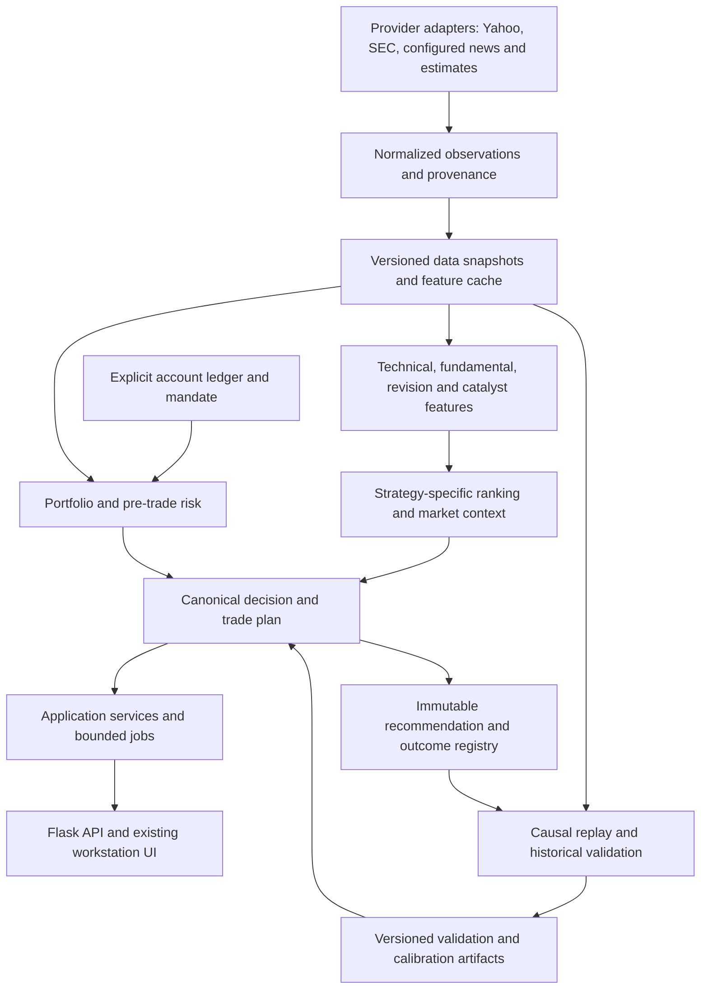

# QUANTA Elite: architecture, trading intelligence, and product audit

Audit date: 2026-09-07. Code baseline: `cba4ec9ac3233286b6a4ffc2580f22ce29860193`, branch `quanta-review-redesign`.

This is an audit and implementation proposal. No application code was changed for this audit. File locations below are relative to the repository root; line numbers identify the audited baseline. Synthetic examples are test inputs, not market observations.

## 1. Executive Summary

**QUANTA is a useful research workstation with substantial engineering investment. It is not ready to be trusted as the authority for professional capital allocation.** Its strongest assets are explainable screening, explicit rejection reasons, structured data-status work, instrument-aware analysis, and a coherent financial UI. Its weakest link is the consistency between research, trade guidance, portfolio constraints, and validation.

The most consequential confirmed findings are:

- The portfolio backtester processes intraday exits and closing equity before admitting trades at that same day's open. It also misses stops on newly entered positions' entry bars. A synthetic example produces a reported +20% winner where the trade-level labeler correctly records a -10% entry-day stop.
- The deep-dive portfolio check receives positions with dollar `value` fields but sums `weight` fields. It can infer holdings from research signals, and sector-limit adjustments are not enforced by its caller.
- Beginner guidance can simultaneously return `Buy Now: YES` and `Avoid` for the same SELL result.
- Analysis cache behavior can delete the stale result needed during an outage and reuse a fast-preview result for a requested full analysis.
- A provider failure with no usable price can become an `invalid_ticker`, non-retryable error without sufficient evidence that the ticker is invalid.
- The available historical evaluation covers only part of the live composite and does not establish an investable edge. Its trade simulation also needs the execution defects corrected before its statistics can be trusted.

The right next step is a focused correctness program that preserves the existing UI and decision-engine foundations. More scores, more models, and a frontend framework migration would currently have lower value.

**Evidence and validation:** the current offline Python run produced **755 passed, 2 failed, 2 skipped, 5 deselected**. Both failures were missing dependencies: Parquet support and Streamlit. JavaScript tests: **198 passed**. Security-monitor browser tests: **4 passed** across the configured projects. Broader dashboard/browser tests: **5 passed, 1 failed**, with 24px horizontal overflow at 360px. Subsequent targeted probes did not reproduce that overflow; treat it as an intermittent regression requiring isolation. Both dashboard themes passed the automated accessibility checks in that run. `pip check` passed; Ruff was unavailable. npm audit reported one high-severity vulnerable development dependency. Golden replays and the full historical evaluation were not rerun.

The in-app browser backend was unavailable, so existing standalone Playwright checks were used. Browser checks exercised the existing localhost server; its Python process was not restarted to claim a deployment verification of the latest backend. This audit traced the main execution paths and reviewed supporting modules; it is not a claim that every line or every provider integration was exercised.

## 2. Overall Project Score / 10

**5/10 for professional deployment readiness.** These are qualitative audit ratings, not calibrated measurements or an arithmetic average. The research experience is materially stronger than the capital-allocation assurance. Correctness blockers outweigh feature count.

## 3. Architecture Score

**5/10.** There are useful boundaries in `core/engine`, provider helpers, and `core/apex_quant`, but the active application still depends heavily on very large modules, mutable shared runtime objects, import-path manipulation, and duplicate decision logic.

## 4. Quant/Trading Intelligence Score

**4/10.** Many relevant inputs exist, and several conservative gates are valuable. However, empirical validation does not cover the complete live model, confidence is heuristic, portfolio controls are unreliable, and the execution simulator has material chronology errors. Informational breadth does not yet establish alpha.

## 5. Data Reliability Score

**4/10.** Rate-limit handling, cache reuse, SEC retries, and explicit data-status types are good foundations. Their semantics are not consistently preserved across all modules and presentation layers. Units, observation timestamps, historical availability, and session-aware freshness need stronger contracts.

## 6. Backend Engineering Score

**5/10.** Broad tests, validation helpers, background jobs, and structured errors are positives. Job cancellation, singleton analyzer lifetime, cache identity, dependency completeness, and operational persistence limit reliability.

## 7. UI/UX Score

**7/10 for the research interface; lower for a complete portfolio workflow.** The opaque data surfaces, tabular numbers, semantic colors, expandable evidence, keyboard-accessible controls, and restrained navigation deserve preservation. Misleading certainty and inconsistent actions matter more than cosmetic polish. The mobile overflow finding remains unresolved.

## 8. Performance/Reliability Score

**4/10.** Recent dashboard improvements address important waiting and retry failures. Nevertheless, request deadlines do not consistently stop underlying work, cached deep dives wait behind a global lock, and canceled work can continue consuming provider capacity. No controlled load benchmark was performed; optimization rankings below are based on execution-path evidence, not invented latency savings.

## 9. Best 10 Things

1. **Risk-aware recommendation gates.** `SP_ELITE_PRO.py:get_top_recommendations` checks actionability, risk, reward, score quality, and execution constraints before returning candidates.
2. **An existing canonical decision foundation.** `core/engine/decision_engine.py:45`, `resolve_final_action`, provides typed decisions and reasons. Extend this rather than starting another signal engine.
3. **Explicit invalid-data semantics.** `AnalysisResult` carries data status, invalid reasons, provider lineage, and final-action fields; the UI has a dedicated data-quality failure gate.
4. **Instrument-aware analysis.** ETF, ADR, and financial-company distinctions avoid applying every company valuation measure to every instrument.
5. **Honest partial historical reconstruction.** `apex_quant/elite_scorer.py` deliberately freezes unavailable historical components instead of substituting today's fundamentals into the past.
6. **Useful statistical diagnostics.** OOS reports include component IC, bucket monotonicity, non-overlapping observations, baselines, and explicit limitations. Publishing unfavorable results is a strength.
7. **Cross-sectional normalization already exists.** `SP_ELITE_PRO.py:5560`, `normalize_scores`, and its collinearity diagnostics provide a foundation for investigating redundant factors.
8. **Provider resilience work is substantive.** Shared SEC request/cache handling, retryable failures, Yahoo cooldowns, and the latest dashboard single-flight/degraded-response handling are worth keeping.
9. **A coherent financial design system.** `static/quanta.css` centralizes tokens and keeps data panels opaque. Security-monitor coverage and exclusions are visible instead of suggesting whole-exchange completeness.
10. **Meaningful regression coverage.** Hundreds of Python tests plus DOM and browser checks provide a base for safely addressing the remaining financial invariants.

These strengths improve research speed and explainability. They should not be presented as proof of predictive edge.

## 10. Worst 10 Things

1. Invalid event ordering in portfolio simulation.
2. Research signals being treated as holdings or recorded as trades.
3. Portfolio exposure checks that do not consume or enforce the actual proposed exposure.
4. Contradictory action messages across decision and guidance layers.
5. Heuristic conviction and model output presented as percentage confidence.
6. Incomplete live-model validation and a static, survivor-selected historical universe.
7. Cache identity and expiry behavior that undermine full analysis and outage fallback.
8. Timeouts and cancellation that can leave heavy work running concurrently.
9. Data failures, proxy measures, and missing values acquiring stronger meanings downstream.
10. Large overlapping engines and an incomplete reproducible validation environment.

## 11. Critical Bugs / Blockers

### F01 — CRITICAL: simulator execution chronology is invalid

**Location:** `stock-analysis/core/apex_quant/simulator.py:66`, `simulate`; particularly the exits, close mark-to-market, and subsequent open-entry blocks. Compare `core/apex_quant/labeling.py:32`, `simulate_forward`.

**Problem → reason → impact:** existing positions exit using today's high/low; remaining equity is marked at today's close; only then are new trades sized and bought at today's open. This admits information and cash that would not have existed at the entry time. Newly entered positions miss that day's stop/target checks entirely. Stops also fill at the stop level even when the whole bar gaps below it.

**Reproduced:** signal before entry; entry 100, stop 90, target 120; entry-day low 85; following-day high 121. Portfolio simulation reports +20%; the forward trade labeler reports -10%. Separately, a bar with open 70/high 75/low 65 still receives a stop fill at 90 in the labeler. These are deterministic synthetic examples with zero costs.

**Fix:** establish one causal execution model: prior-known sizing inputs, opening gaps, open fills, explicit same-bar ambiguity rules, intraday exits, and end-of-day equity. Share execution semantics between labeling and portfolio simulation. Explicitly define terminal holdings, closing costs, and initial equity in returns. Recompute affected reports. **P0 / High complexity / Very High impact.**

### F02 — CRITICAL: portfolio guidance is not grounded in enforceable holdings

**Location:** `TradingAnalysis_ELITE.py:7332`, `_get_tracked_positions`; `:5666`, local `PortfolioRiskManager.check_position_limits`; `:7727`, analyzer integration; `:7764`, compliance recording.

**Problem → reason → impact:** fallback holdings are reconstructed from BUY research records at an assumed 100 shares. The returned positions contain `value`, while the risk manager sums `weight`, yielding zero sector exposure. Even with proper weights, sector excess only produces an adjustment; the caller acts only when `approved` becomes false. The proposed position dictionary is created but not passed into the check. Research analysis also invokes `record_trade` before the final decision reconciliation.

**Reproduced:** a synthetic BUY observation at 100 becomes an inferred 10,000 holding. A 90,000 Technology position supplied using the caller's schema produces zero Technology exposure and approval. Supplying a 0.9 weight produces a warning/adjustment but still approval.

**Fix:** separate observations, recommendations, orders, fills, and holdings. Require explicit holdings/cash or label the result a hypothetical allocation. Compute weights from a consistent account snapshot, include the proposed trade, enforce limits, and recalculate all sizing fields after adjustments. Never create executed-trade records from analysis. **P0 / High / Very High.**

### F03 — HIGH: one result can recommend both buying and avoiding

**Location:** `TradingAnalysis_ELITE.py:10480`, `_compute_beginner_guidance`, especially `:10537` and the sell override around `:10615`; serialized at `:12849`. Presentation also has independent classifications in `static/app.js:5081` and `:5329`.

**Problem → reason → impact:** candle confluence sets `buy_now=YES` independently of the final signal. The explicit sell override changes audience guidance but does not reset `buy_now`, timing, or the original action sentence.

**Reproduced:** a synthetic SELL result with bullish candle confluence and valid 2:1 reward/risk returns `buy_now=YES`, `timing=GOOD BUY SETUP`, `new_buyer=Avoid`, `short_tf=Avoid`, and `data_quality=WARN`. The frontend's hard-failure gate does not establish a universal cure for this WARN case.

**Fix:** derive all actionable text from one final decision and one audience context. Candle timing may explain conditions but may not promote an action beyond the resolved decision. Test forbidden combinations across API, CLI, and UI. **P0 / Medium / Very High.**

### F04 — HIGH: stale cache fallback and full-analysis cache identity are wrong

**Location:** `ui/stock-analysis/webapp/app.py:3583`, `_get_cached_analysis`; `:3609`, `_set_cached_analysis`; `:4927`, worker cache branch.

**Problem → reason → impact:** a normal lookup deletes an expired result, so the later stale lookup cannot recover it. The worker also returns a fresh cached result by ticker without checking whether a requested full analysis is being satisfied by a fast preview. Its outage branch supplies no stale payload.

**Evidence:** stale lookup failure was reproduced directly. The cache key and unconditional return confirm the mode mismatch path; it was not exercised against a live full-analysis provider run.

**Fix:** retain last-good results under a separate maximum retention policy; distinguish freshness from existence. Include analysis completeness/mode and model/configuration version in cache eligibility. A full request must not be satisfied by a preview. **P0 / Medium / High.**

### F05 — HIGH: provider failure can be mislabeled as an invalid ticker

**Location:** `app.py:5036–5057`, `_run_analysis` no-price handling.

**Problem → reason → impact:** after unsuccessful attempts, the terminal response can use `error_type=invalid_ticker` and `retryable=False` even when the result has not established ticker invalidity. A temporary outage becomes a misleading permanent conclusion.

**Fix:** preserve the engine's typed data status through the job envelope. Use distinct statuses for validated invalid instrument, no historical coverage, timeout, rate limit, and unavailable provider. Test the HTTP response, not just the internal helper. **P0 / Low / High.**

### F06 — HIGH: earnings surprise unit inference changes values discontinuously

**Location:** `stock-analysis/modules/earnings_revision_scoring.py:159`, `_avg_surprise_pct`, scaling at `:184`.

**Problem → reason → impact:** values with magnitude at most 1 are multiplied by 100; larger ones are not. This cannot distinguish a small percentage surprise from a fraction. Rankings can change dramatically around an arbitrary boundary.

**Reproduced:** input 0.99 becomes 99.0, while 1.01 remains 1.01. This proves the normalization defect; it does not identify the frequency of affected current provider observations.

**Fix:** normalize against an explicit adapter/version schema, retain raw units and normalized units, and test small/large/negative surprises. Do not infer units from magnitude. **P0 / Low / High.**

### F07 — HIGH: cancellation and timeout can allow overlapping heavy work

**Location:** `app.py:4883`, `_run_analysis`, executor around `:4983`; `:5168`, `job_cancel`; `:4330`, `_run_stock_picks`.

**Problem → reason → impact:** canceling a job changes metadata without stopping the scan. A new scan can be admitted while the canceled one still consumes resources. An analysis timeout cannot kill its running Python thread, yet the serialization lock is released and a subsequent request can reuse the same mutable analyzer. This creates a credible concurrency and provider-load risk. A saturation test was not performed.

**Fix:** retain worker ownership until actual completion; use bounded admission and cooperative cancellation between stages. If a hard deadline must terminate a provider stall, isolate that work in a disposable process. Do not solve this by merely adding threads. **P0 / High / High.**

### F08 — HIGH: enabled sector diversification can be relaxed automatically

**Location:** `SP_ELITE_PRO.py:10526`, `get_top_recommendations`.

**Problem → reason → impact:** when four or fewer candidates qualify, the sector cap becomes 100%, even when diversification was requested. A `sector_cap_relaxed` flag exists, so this is not a hidden change, but the user's constraint is no longer enforced.

**Fix:** keep mandate constraints binding. Return fewer positions or cash, with an explicit explanation. Any relaxation should be an intentional scenario choice. **P0 / Low / High.**

## 12. Quant & Methodology Risks

**Confidence and probability — HIGH.** `SignalGenerator._determine_signal` at `TradingAnalysis_ELITE.py:5563` starts confidence from composite score and applies hand-coded adjustments. `_confidence_tier` in `core/engine/decision_engine.py:35` derives a tier from score and overrides. Neither establishes forecast calibration. `PositionSizer._calculate_dynamic_win_probability` at `:5997` blends a heuristic base, limited signal-history statistics, hard-coded technical increments, and Monte Carlo terminal-profit probability. Terminal profit probability is not the probability of hitting a target before a stop. The existing risk-budget sizing is a useful safeguard, but the displayed probability/Kelly interpretation remains unsupported.

**Recommendation:** call the current output “heuristic conviction” or a score. Show probability only with a defined event, horizon, calibration sample, reliability curve, and uncertainty interval. Do not invent new weights to make the current score look calibrated.

**Historical evidence — HIGH.** The saved `core/apex_quant/_reports/elite_oos.txt`, generated 2026-08-27, covers 42 tickers and only 40% of the SIDEWAYS model weight. It reports composite mean IC of -0.0225 at 21 days and -0.0339 at 63 days, with non-monotonic buckets. The saved `elite_walkforward.txt` reports strategy Sharpe 0.12 versus SPY 0.66 and random-exit 0.43. These are archived repository artifacts, not a fresh validation. The trade metrics require recomputation after F01; the partial factor study does not validate the complete live model. Do not conclude that negative partial-model IC proves every QUANTA feature lacks value.

**Bias assessment:**

| Risk | Finding | Required response |
|---|---|---|
| Look-ahead | Confirmed in simulator equity/cash timing | Correct event chronology and lock causal regression fixtures |
| Future fundamentals | Historical scorer intentionally freezes unavailable fields | Preserve this safeguard; obtain historical availability timestamps before expanding coverage |
| Survivorship/selection | Static present-day 42-name universe | Add dated membership, delistings, identifier changes, and failed names |
| Historical joins | Full PIT fundamentals provider is abstract/unimplemented | Join on when a fact became knowable, not fiscal period end |
| Corporate-action hindsight | Truncating today's adjusted history does not by itself prove historical knowledge equivalence | Validate adjustment vintages and use execution-consistent prices |
| Overfitting | Parameter searches exist; no proof that the complete live scoring hierarchy generalizes | Freeze hypotheses, reserve untouched periods, report trial counts and stability |
| Overlapping outcomes | Existing OOS code uses non-overlapping samples for key statistics | Keep this; purge/embargo label overlap where training targets extend across folds |
| Validation drift | `apex_quant/validation.py:61` primarily checks pass status and age | Bind approval to code, parameters, universe, data, costs, and complete strategy identity |

Chronological splits and a gap are useful building blocks, but a generic time split alone does not solve overlapping financial labels. [TimeSeriesSplit documentation](https://scikit-learn.org/stable/modules/generated/sklearn.model_selection.TimeSeriesSplit.html).

**Factor-by-factor assessment:**

| Area | Assessment and recommendation |
|---|---|
| Technicals and momentum | Useful setup descriptions. RSI, MACD, moving averages, trend, and relative strength share price information; measure incremental contribution rather than treating each as independent confirmation. |
| Relative strength | Preserve benchmark/sector-relative comparisons. Make lookback, benchmark, and eligible comparison universe explicit. |
| Factor model | `core/quant/factor_model.py:85`, `FactorExposureModel`, uses ETF return proxies. These are useful exposure approximations, not canonical Fama–French factors. Rename clearly and prioritize portfolio diagnostics over another alpha score. No main-workflow integration was found in the inspected imports. |
| Fundamentals | Quality measures can anchor research. Missing or inapplicable data must remain distinguishable from weak business performance. Do not feed default zeros into economic judgments. |
| Valuation | `ValuationAnalyzer._calculate_dcf` at `:4479` substitutes positive growth assumptions, anchors extreme estimates back to price, and blends analyst targets for some stocks. The result is not an independent DCF observation. Expose scenarios, assumptions, and source dependence. |
| Earnings/revisions | High potential decision value, but fix F06 and preserve estimate timestamp, reporting period, coverage, and revision direction. Analyst target changes are not substitutes for EPS revisions. |
| Sentiment/news | VADER and keyword interpretation help triage reading; they are not validated return forecasts. Deduplicating exact titles is helpful but does not remove syndicated-story dependence. |
| Sector/regime | Use as context and admissibility/risk controls. Avoid repeatedly counting the same index trend in regime, confidence, allocation, and final recommendation without attribution. |
| Breadth | Current dashboard participation measures a small index/ETF basket, not exchange constituent breadth. Rename until constituent coverage exists. |
| Volatility/Monte Carlo | Keep deterministic reproducibility and bounded assumptions. Present scenario distributions conditional on the model, not a demonstrated chance of trading success. |
| Entries/stops/targets | Preserve explicit invalidation and net reward/risk. Align horizons: a 12-month valuation target does not automatically justify a short-term stop and swing-trade expected return. |
| Position sizing | Base on actual equity, cash, stop distance, liquidity, portfolio constraints, and a declared mandate. Keep heuristic conviction separate from estimated event probability. |

**Cleaner scoring hierarchy:** keep separate outputs for (1) eligibility/data sufficiency, (2) absolute setup quality, (3) cross-sectional and sector-relative rank, (4) market/sector context, (5) trade economics, and (6) portfolio admissibility. The final action consumes these outputs with reasons. Risk is principally a constraint, not compensation for weak alpha. Preserve existing percentile normalization where appropriate; do not let being the best of a bad universe create an actionable trade.

## 13. Data Quality Risks

**Confirmed remaining semantic failures:** F05 misclassifies unavailable data; F06 guesses units; F04 destroys last-good fallback. `TradingAnalysis_ELITE.py:3416`, sentiment analysis, also returns an empty/default result when no articles arrive, whether that means no news, missing credentials, or failed fetches. Optional failure need not block all analysis, but its status must survive aggregation.

**False moving-average label — HIGH:** `app.py:1591`, `_trend_metrics`, sets `sma200` to the mean of shorter history when fewer than 150 closes exist; it can label a roughly 60-bar average as a 200-day measure. Require 200 valid sessions or return unavailable with observed coverage. Do not silently substitute a different indicator.

**Breadth semantics — MEDIUM:** `app.py:2640–2669` calculates participation from SPY/QQQ/DIA/IWM, or four Indian indices, and `static/app.js:1707` displays “Breadth.” A 75% result can mean three of four proxies, with substantial overlap. Show “Index participation: 3/4 above 50-day MA,” including missing members. A failed subset must not make the remaining sample look more representative.

**Freshness — HIGH:** web Yahoo caches use a 15-minute history TTL and one-hour `.info` TTL (`app.py:167–168`). `.info` contains market-sensitive fields as well as slow company metadata. Retrieval age is not quote age; a fresh request may contain a prior-session observation. Separate datasets by update behavior and preserve provider observation timestamps and session state.

**Historical fundamentals/estimates — HIGH:** `apex_quant/data_provider.py:55`, `FundamentalsProvider`, establishes an interface but not a usable historical source. SEC submissions help identify filings, but do not automatically supply normalized as-known estimates, complete fundamentals, or corporate-action history.

**Dates/corporate actions — validation gap:** top-level lineage fields are a good start. End-to-end coverage for splits, dividends, ticker changes, earnings dates, exchange holidays, mixed adjusted/unadjusted prices, and India/US session transitions was not established by this audit. These need fixtures rather than assumed correctness. The dashboard itself describes the catalyst window as both “7 sessions” and “7-day window” in `templates/index.html`; choose a precise contract.

**Recommended data envelope:** instrument ID, source, value, unit, currency, observation time, publication/availability time, retrieval time, session, adjustment basis, coverage, quality status, error reason, and stale eligibility. Avoid turning these into many permanent UI badges; surface the material exceptions and offer provenance on demand.

Use separate result states: `NO_SIGNAL` means sufficient valid data was evaluated and no setup passed; `INSUFFICIENT_DATA` means a conclusion could not be computed; `PROVIDER_UNAVAILABLE`, `RATE_LIMITED`, and `INVALID_INSTRUMENT` retain their distinct meanings. Optional missing data may yield a clearly labeled partial analysis. Required invalid data must suppress actionability.

## 14. Architecture Problems

**Actual architecture and execution:**

| Component | Actual responsibility |
|---|---|
| `ui/stock-analysis/webapp/app.py` | Flask API, Yahoo monkey patches, caches, news, market/regime calculations, background jobs, serialization, and engine orchestration |
| `static/app.js`, `elite-pro.js`, `dashboard-workspace.js` | Vanilla JavaScript state, DOM generation, forms, SSE/polling, dashboard synthesis, and additional recommendation presentation logic |
| `core/SP_ELITE_PRO.py` | Main web scanner, normalized multi-factor ranking, gates, deep confirmation, allocation candidates |
| `core/TradingAnalysis_ELITE.py` | Single-security analysis, provider calls, technical/fundamental/risk/valuation/news components, signal generation, sizing, and reports |
| `core/SP_ShortTerm.py` | Separate short-term analysis/scanning path with its own assumptions |
| `core/Alpha_Picks_Engine.py` | Separate fundamental/analyst-oriented selection path |
| `core/engine` | Typed data/decision contracts, validation, and final-action resolution |
| `core/apex_quant` | Price-based historical reconstruction, labels, simulation, walk-forward diagnostics, and validation artifacts |
| `modules` | Provider, SEC, earnings, catalyst, portfolio, compliance, and multiple backtesting helpers; integration varies by entry point |

`GET /api/dashboard` builds market/news state and starts or reuses market intelligence. `GET /api/market-intel` polls that background result. `POST /api/stock-picks` starts `_run_stock_picks`, which invokes `QuantaEliteTradingSystem`, obtains gated recommendations, applies web risk-profile sizing, and serializes results. `POST /api/analyze` starts `_run_analysis`, which reuses an analyzer runtime and cache. Jobs are read through status endpoints and SSE. These are research jobs; no executed-order workflow was found in the web routes.

**HIGH:** the primary Python engines are roughly 12k and 14k lines, while the API and main browser script each span several thousand lines. Provider I/O, calculations, policy, and presentation are interleaved, making one-result consistency difficult to enforce.

**HIGH:** multiple engines and presentation layers own related scoring, risk, and decision concepts. `TradingAnalysis_ELITE.py` imports a portfolio manager but also defines a same-named local class. This weakens clarity about which implementation actually protects the live path.

**MEDIUM:** bare sibling imports and `sys.path` manipulation remain part of deployment. The package metadata intentionally does not package the application modules. This is workable for a checkout tool but fragile for repeatable deployment.

**MEDIUM:** jobs and important caches are process-local. Restarting loses job state; multiple workers would need shared ownership, not independent copies of the current dictionaries and locks.

**Do not overcorrect:** no verified circular-import failure was found, and a modular monolith remains appropriate. Extract boundaries around tested behavior incrementally; do not introduce microservices or rewrite the frontend merely to reduce file size.

## 15. Backend Problems

**Reliability:** fix F04/F05/F07 first. Move eligible cache reads ahead of analyzer-slot acquisition. Return consistent error envelopes, preserve provider exceptions as structured categories, and make terminal job states explicit in both SSE and polling. `static/app.js:5733`, `pollJob`, and `fallbackPoll` handle complete/error but not all canceled-state cleanup; interval polling also lacks an in-flight guard and can overlap under slow responses.

**Account context:** `_run_analysis` submits `analyzer.analyze` without `account_size` (`app.py:4986`); the analyzer default is 100,000 (`TradingAnalysis_ELITE.py:7371`). The portfolio scanner has separately configurable capital. A security's deep-dive size therefore does not necessarily belong to the scanner's mandate. Thread a shared account/scenario ID through the request and visibly identify hypothetical sizing.

**Tests and installation:** `test_recommendation_trace.py:21` requires a Parquet engine, which is not declared in the relevant installation set. `test_streamlit_support.py:259` requires Streamlit, while `.github/workflows/stock-analysis-ci.yml` installs `.[dev,webapp]` for its unit job. This is an installation-contract problem, not evidence of a financial calculation failure. CI also has no JavaScript/browser step in this workflow. Align extras, test markers, and CI coverage. Keep golden fixtures, but add financial invariants that can fail even when an old snapshot remains unchanged.

**Observability:** preserve existing provider health, scan counts, cooldown information, and deep-dive stage timings. Add request/job/provider correlation IDs; queue wait versus execution duration; cache hit, stale serve, and rejected cache-mode counts; timed-out-but-still-running worker counts; provider response coverage; final-action reason distributions; and signal-to-outcome lineage. Put operational details in logs/diagnostics, while the trader sees freshness, completeness, and affected conclusions.

**Security findings:**

| Severity | Location and evidence | Recommendation / scope |
|---|---|---|
| HIGH | `app.py:1176`, RSS fetch fallback uses `ssl._create_unverified_context()` after certificate failure | Remove certificate bypass; repair trust configuration or report the feed unavailable. A network attacker scenario was not exercised. |
| HIGH | `modules/api_manager.py:31`, `_safe_request`, prints request exceptions; caller URLs include query API keys | Log provider/status and a redacted endpoint. Exception strings can contain the full URL. No actual credential exposure was printed or asserted. |
| MEDIUM | `app.py:204`, persisted cache loaded with pickle | Replace with a non-executable format or explicitly trusted, permission-restricted local storage. Requires cache tampering; this is not a demonstrated remote exploit. |
| MEDIUM locally; HIGH before shared deployment | Loopback launch guard exists, but application routes do not establish authentication/authorization or trusted-origin/host controls | Preserve loopback scope. Before shared access, add identity, endpoint authorization, request-size/admission limits, and origin/host protections. Do not assume the development launch guard secures every WSGI deployment. |
| HIGH advisory; limited current exposure | npm audit reports one vulnerable transitive development package, `undici`, with a fix available | Update the relevant development dependency/lockfile and rerun tests. This is not evidence that QUANTA's browser production code directly executes the vulnerable paths. |

A scoped literal-secret pattern scan found no candidates in the selected code/config file types. It was not a complete repository-history or runtime-secret audit. Python package vulnerabilities were not audited; `pip check` only checks installed dependency compatibility. Flask documents application responsibilities for resource limits, request security, and trusted hosts. [Flask security documentation](https://flask.palletsprojects.com/en/stable/web-security/). The current npm finding includes an upstream cache-handling advisory. [Undici advisory](https://github.com/nodejs/undici/security/advisories/GHSA-4cwx-7wf7-3272).

## 16. UI/UX Problems

**Overall direction:** retain the workstation's flat, readable data surfaces and progressive disclosure. The code's primary text is 13–14px and metadata 11–12px; this is not evidence that the whole interface uses unreadably tiny type. Improve specific dense metadata and mobile behavior with measured tests rather than a wholesale typography redesign.

**Confirmed content problem:** the UI prints heuristic confidence with `%` (`static/app.js:768`, `:4723`) and labels proxy participation as breadth. These visual choices imply stronger knowledge than the implementation supports. Correct the meaning before changing the styling.

**Workflow problem:** Overview, Portfolio Builder, and Research are useful entry points, but a scan-generated “Position List” is not an account portfolio. Watchlist/monitor functionality exists; persistent thesis management, actual holdings, alert lifecycle, and outcome attribution are incomplete as a connected web workflow. Separate “proposed allocation” from “current holdings” in terminology and data.

**Density problem:** the deep dive contains a decision hero, executive summary, plan, setup, chart, brief, targets/Monte Carlo, street/insider, scores, sizing, news, detail, risk, and outlook (`static/app.js` around `:5389`). This creates repeated conclusions and long reading paths. Consolidate around Decision → Trade plan → Why/what changes → Evidence. Keep optional model detail collapsed, especially Monte Carlo and uncalibrated metrics.

**Browser evidence:** one responsive test observed 24px page overflow at 360px; later focused probes were clean. This is a real failed check, with intermittent cause still uncertain. Monitor overflow/sorting/accessibility passed all four configured projects. Dashboard dark/light accessibility and navigation-overlap checks passed. No claim of full deep-dive visual validation follows from those checks.

| Trader question | Current answer | Needed improvement |
|---|---|---|
| 1. Market regime? | Visible and explained | Separate model conviction from probability; show proxy coverage |
| 2. Leading sectors/themes? | Some sector/context signals, fragmented | One dated relative-strength/leadership view with benchmark and horizon |
| 3. Strongest opportunities? | Gated scan results and research candidates | Keep qualification level and scan coverage prominent |
| 4. What should I avoid? | Avoid/veto queues and chase warnings | Preserve specific rejection and requalification conditions |
| 5. Actionable now? | Multiple action/guidance fields | Resolve F03 and use one authoritative action |
| 6. Preferred entry? | Entry/pullback/confirmation values exist | One horizon-specific plan tied to the final decision |
| 7. Invalidation/stop? | Explicit levels exist | Show thesis invalidation separately from execution assumptions |
| 8. Targets? | Several targets and valuation views | Label horizon, source, assumptions, and dependency |
| 9. Reward/risk? | Available and often net of costs | Use the same entry, stop, target, horizon, and costs everywhere |
| 10. Thesis-changing catalyst? | News, filings, and calendar surfaces exist | Dated event, evidence, uncertainty, and explicit thesis consequence |
| 11. Portfolio exposure/risk? | Inferred/proposed allocation, incomplete holdings integration | Real reconciled positions, cash, concentration, correlation, and stress |
| 12. How much to allocate? | Scanner and deep dive both size | One account/mandate context, enforced constraints, clearly hypothetical alternatives |

## 17. Performance Problems

Ranked by expected impact; savings must be measured before claiming success.

| Rank | Bottleneck / location | Recommended optimization | Priority / complexity / impact |
|---|---|---|---|
| 1 | Running work survives cancellation/timeouts, F07 | Bound admission and provider work; preserve ownership until completion | P0 / High / High |
| 2 | Cache lookup follows a possible 90s analyzer-lock wait, `app.py:4883` | Serve compatible fresh/stale results before joining the compute queue | P1 / Low / High |
| 3 | Provider I/O and calculations recur across scanner and deep confirmation | Reuse normalized data/features by instrument, as-of, adjustment basis, and version | P1 / Medium / High |
| 4 | Process-wide Yahoo monkey patches and separate engine/provider caches | Consolidate provider coordination incrementally; measure call counts and cooldown pressure | P1 / High / High |
| 5 | Legacy sentiment uses `as_completed` without a batch timeout, then calls `future.result(timeout=20)` on already-completed futures | Apply an actual batch deadline and provider-level timeouts; avoid executor-context shutdown waiting indefinitely | P1 / Medium / High |
| 6 | Job polling can overlap and lacks complete cancellation teardown | One in-flight poll, bounded backoff, abort on view/job replacement, handle all terminal states | P1 / Low / Medium |
| 7 | Large DOM strings and layered rendering in `app.js`/`elite-pro.js` | Profile first; defer hidden sections and update only changed rows where material | P2 / Medium / Medium |

Retain the recent market-tape fallback, no-empty-cache behavior, market-intelligence single-flight work, and dashboard response-generation guards. A client timeout is useful, but it is not proof the server or provider stopped working. Do not weaken financial checks to achieve a faster result; label previews and track their completeness.

Suggested operational targets to validate, not current measurements: immediate cached responses, bounded queue time, predictable partial-preview latency, no increase in provider concurrency after cancellation, and no stale market response replacing the currently selected market. Measure p50/p95, cold versus warm cache, provider call count, completeness, and peak active workers.

## 18. What Should Be Removed/Merged

| Decision | Component | Rationale |
|---|---|---|
| REMOVE | Uncalibrated probability wording; “more target sources = higher confidence” in `TradingAnalysis_ELITE.py:4700` | Correlated sources and heuristic counts do not establish probability |
| REMOVE | Inferring executions/holdings from research; certificate-validation bypass | False account state and avoidable trust failure |
| MERGE | Final-action, beginner guidance, and frontend recommendation overrides | One policy contract with audience-specific wording |
| MERGE | Same-named portfolio managers and duplicate sizing enforcement | One verified holdings schema and constraint implementation |
| SIMPLIFY | Repeated summary/outlook/action cards | One decision and plan, with evidence on demand |
| REBUILD | Shared execution semantics underneath labeling/backtesting | Financial chronology is wrong; preserve surrounding diagnostics |
| KEEP | `core/engine`, explicit rejection reasons, instrument classification, normalized scores, test fixtures, design tokens | These provide useful structure and regression protection |
| EXPAND | Provider provenance, earnings revisions, historical validation, portfolio lineage | These close actual decision gaps |
| REVIEW BEFORE REMOVAL | `core/quant` helpers, `robust_backtesting_engine`, standalone catalyst integrations, old utility scripts | Some have no main-path importer in the inspected code. Confirm CLI/external consumers; unintegrated does not prove unused everywhere. |

Do not replace four independent engines with one untested mega-score. First document their different mandates, extract shared data and risk primitives, and compare disagreements using frozen cases.

## 19. Missing Capabilities

The central gap is a complete decision lifecycle: **observation → qualified idea → reviewed plan → recorded execution → holdings → outcome → model learning**. QUANTA has substantial work in the first three stages, with incomplete or conflated later stages.

The highest-value missing capabilities are: an authoritative portfolio ledger; complete data provenance and as-known history; versioned recommendation/outcome records; validated full-strategy evaluation; and alerts tied to changes in a saved thesis. Constituent breadth and coherent sector leadership are worthwhile after provider and timestamp contracts are trustworthy.

Institutional-flow inference, options-implied expectations, and more complex predictive models should wait for a concrete user question and adequate data. OHLCV volume is not proof of institutional ownership changes; a generic options widget is not automatically useful.

## 20. Best New Modules

These are bounded additions or extensions to existing code, not a proposal for six new services.

| Proposal | Purpose and trading value | Required data | How it works / dependencies | Complexity / expected impact |
|---|---|---|---|---|
| Portfolio state and pre-trade risk | Make allocation fit the actual account; prevent unintended exposure | Positions, fills, cash, currency, prices, sectors, mandate | Reconcile a ledger; calculate pre/post-trade concentration and risk; reuse corrected portfolio helpers and sizing | High / Very High; P0–P1 |
| Decision and outcome registry | Know which version recommended what and whether the plan worked | Frozen inputs, final action, entry/stop/target/horizon, model/data versions, later bars/fills | Save immutable recommendation records, then label plan outcomes separately from execution P&L; depends on F01/F03 | Medium / Very High; P1 |
| Data provenance and replay | Reproduce decisions and isolate provider failure | Raw responses, observation/publication/retrieval times, units, adjustments | Normalize through adapters; retain snapshots and quality states; extend existing provider/cache work | High / Very High; P1 |
| Earnings and catalyst timeline | Distinguish improving estimates from stale headlines; identify thesis risk | Dated estimate vintages, earnings schedule, filings, sourced events | Extend earnings/SEC/catalyst modules; record event certainty and time; link revisions to the saved thesis | Medium–High / High; P1–P2 |
| Market participation and leadership | Detect narrow rallies and persistent sector leaders | Dated universe, constituent prices, sector membership, benchmark history | Compute coverage-aware breadth and sector-relative strength; reuse technical features; avoid survivorship shortcuts | Medium–High / High; P2 |
| Thesis-change alerts | Reduce constant dashboard checking while preserving action discipline | Saved ideas, levels, earnings/events, provider freshness | Alert only on defined invalidation, confirmation, event change, or evidence deterioration; deduplicate and acknowledge | Medium / High; P2 |

Portfolio stress testing belongs inside the portfolio capability: historical shock scenarios and transparent factor/sector shocks first. It needs actual exposures and a documented price/FX basis. An advanced optimizer would be premature before those inputs work.

## 21. Most Innovative New Ideas

1. **Decision delta:** show what changed since the last saved recommendation, how it changed the action, and which input caused it. Useful for a PM or analyst reviewing many names. Requires versioned snapshots and the unified decision contract. **P2 / Medium / High.**
2. **Evidence dependency map:** show when “three confirmations” all depend on the same price trend or analyst target. Helps a quant or risk manager detect false independence. Start with declared source lineage, then empirical factor ablations. **P2 / Medium / High.**
3. **Requalification plan:** every rejected idea gets an explicit condition under which it could become valid, an expiry, and a data sufficiency requirement. Extends the existing veto queue for swing-trader workflow. **P2 / Medium / High.**
4. **Portfolio opportunity cost:** compare adding a candidate with holding cash or reducing an existing exposure under the same risk budget. Explain incremental concentration and scenario risk, without pretending to know precise future returns. **P2 / High / High; dependent on real holdings.**
5. **Thesis fragility:** recompute the decision over reasonable changes in entry price, costs, missing optional data, and model assumptions. Highlight recommendations that flip under tiny changes. This is robustness analysis, not a new probability score. **P2 / Medium / High.**
6. **Calibrated expectation card:** eventually show historical target-before-stop frequency for a matching setup/horizon, with sample size and uncertainty. Suppress it when data are insufficient. **P3 / High / potentially High; experimental until validated.**

## 22. Quick Wins

- Correct the earnings-unit contract and short-history “200-day” label.
- Preserve data failure categories through the API; keep last-good analysis available for labeled fallback.
- Prevent fast-preview cache hits from satisfying full requests.
- Remove probability wording from heuristic confidence and rename the four-proxy breadth measure.
- Keep diversification limits binding and identify the account used for sizing.
- Align Parquet/Streamlit test dependencies and add JavaScript checks to CI.
- Update the vulnerable development dependency, remove RSS TLS bypass, and redact request-exception URLs.
- Isolate the intermittent mobile overflow with deterministic loading/resize fixtures.

These are mostly Low–Medium complexity. Their value is correctness and clarity, not new visual decoration.

## 23. High-Impact Improvements

**One authoritative decision:** extend `core/engine` to own final action, audience context, actionable plan, required-data status, and constraint reasons. All UI/CLI explanations consume it. This directly eliminates a class of contradictory guidance.

**One authoritative portfolio snapshot:** stop using research history as ownership. Thread account identity and a pre/post-trade risk result through both scanner and deep dive. Unknown holdings must produce hypothetical guidance, not a passing portfolio check.

**Trustworthy historical evaluation:** fix execution chronology first; then test the actual strategy version with realistic costs, dated membership, source availability, baselines, and untouched evaluation periods. Do not tune weights against the old invalid trade statistics.

**Reliable workload control:** use bounded jobs, provider coordination, correct stale-cache retention, and execution ownership. A timeout must have a defined effect on both the response and the worker.

**Decision lineage:** persist the evidence used for each action. This connects research, risk, observability, debugging, and future calibration with less duplication than adding independent “intelligence” scores.

## 24. Recommended Target Architecture

Keep a **modular monolith** and the current web UI while extracting these responsibilities:

Build outward from `core/engine`, existing analyzers, provider helpers, and `apex_quant`. Provider adapters own units, timeouts, rate-limit status, and raw provenance. Features should become deterministic functions over normalized inputs where practical. Strategy modules can keep different horizons and mandates. Risk checks consume real proposed orders and holdings. API services coordinate work rather than recomputing financial policy. UI renders the authoritative result and its evidence.

A small local database such as SQLite is a reasonable first implementation for jobs, recommendation records, and a single-user ledger, subject to measured concurrency needs. Do not require Redis, microservices, a message bus, or a frontend framework migration before the correctness work. For shared deployment, revisit durable job execution and account isolation deliberately.

## 25. Prioritized Implementation Roadmap

**P0 — correctness gate.** Fix F01–F08, suppress unsupported action/probability interpretations, and correct required-data semantics. Exit criteria: entry-bar/gap/chronology fixtures agree across labeler and simulator; SELL/AVOID cannot emit unconditional BUY; portfolio constraints use actual pre/post-trade exposure; full requests cannot return previews; outages do not become invalid tickers; cancellation cannot admit uncontrolled overlapping work.

**P1 — reliable research release.** Establish normalized data envelopes, explicit account context, reproducible dependencies/CI, secure provider handling, bounded execution, and immutable recommendation records. Exit criteria: provider-failure and cache fixtures pass; all maintained test suites run from documented installs; worker/resource metrics are available; baseline scan/deep-dive latency and completeness are measured.

**P2 — connected workstation.** Add holdings-aware stress views, dated sector/breadth context, earnings/catalyst timeline, saved thesis alerts, and decision deltas. Consolidate repeated UI summaries. Exit criteria: a trader can move from an idea to a reviewed plan and later inspect what changed and what happened without confusing simulation with execution.

**P3 — validated experimentation.** Consider conditional probabilities, options-implied expectations, advanced factor attribution, and adaptive weighting only with adequate historical data and independent evaluation. Exit criteria: demonstrated incremental decision value after costs and uncertainty, not merely a more impressive dashboard.

Complexity labels describe engineering scope, not delivery promises. Data acquisition and historical coverage can dominate schedule. Avoid calendar commitments before confirming those dependencies.

| Rank | Recommendation | Why | Category | Priority | Complexity | Impact |
|---|---|---|---|---|---|---|
| 1 | Correct and unify simulator/label execution semantics | Current trade outcomes can be wrong | Quant correctness | P0 | High | Very High |
| 2 | Replace inferred holdings with explicit portfolio state and enforced limits | Allocation guidance currently lacks reliable exposure protection | Portfolio risk | P0 | High | Very High |
| 3 | Make final action authoritative across all guidance | One result can say BUY and AVOID | Decision correctness | P0 | Medium | Very High |
| 4 | Repair data statuses, cache retention/mode identity, and units | Prevent false invalidity, missing fallback, preview substitution, and distorted inputs | Data integrity | P0 | Medium | Very High |
| 5 | Bound worker ownership and cancellation | Protect provider capacity and shared analyzer state | Reliability | P0 | High | High |
| 6 | Keep sector constraints binding and align account sizing | Preserve the user's actual mandate | Portfolio risk | P0 | Low–Medium | High |
| 7 | Relabel heuristic confidence and proxy breadth | Remove unsupported precision and scope | Quant / UX | P1 | Low | High |
| 8 | Complete dependency contracts and CI coverage | Make validation reproducible and visible | Testing | P1 | Low–Medium | High |
| 9 | Remove TLS bypass, redact provider errors, update development dependency | Close observed security weaknesses | Security | P1 | Low–Medium | High |
| 10 | Revalidate the complete strategy after simulator repair | Establish what works before adjusting scores or increasing reliance | Quant validation | P1 | High | Very High |
| 11 | Add data provenance and versioned recommendation/outcome records | Enable reproducibility, debugging, and calibration | Data / architecture | P1 | High | Very High |
| 12 | Serve cache before compute admission; share data/features safely | Reduce avoidable waiting and provider calls | Performance | P1 | Medium | High |
| 13 | Consolidate deep-dive decision/plan and isolate mobile overflow | Improve interpretation and responsive reliability | UI/UX | P1–P2 | Medium | Medium |
| 14 | Add real portfolio stress and opportunity-cost views | Assess incremental risk before adding a position | Portfolio intelligence | P2 | High | High |
| 15 | Connect earnings/catalysts, sector leadership, and breadth to saved ideas | Improve contextual decisions with dated evidence | Trading intelligence | P2 | Medium–High | High |
| 16 | Add thesis-change alerts, decision deltas, and requalification plans | Convert research into an ongoing workflow | Product | P2 | Medium | High |
| 17 | Investigate calibrated event probabilities and options expectations | Potentially useful only after data and validation gates | Experimental quant | P3 | High | Uncertain |

### TOP 5 ACTIONS I SHOULD IMPLEMENT FIRST

1. **Repair the execution simulator and labeler.** Every subsequent historical-performance decision depends on correct event ordering, stops, gaps, and costs.
2. **Make portfolio exposure real and enforceable.** Replace research-derived holdings, use actual account inputs, and apply proposed-trade constraints consistently.
3. **Unify final trade guidance.** Eliminate BUY/AVOID contradictions by making all presentation consume the existing canonical decision foundation.
4. **Fix the data and cache contracts.** Preserve unavailable versus invalid versus no signal; retain last-good data; separate preview/full eligibility; normalize explicit units.
5. **Fix job lifecycle and provider admission.** Stop timeouts and canceled jobs from creating overlapping work and unreliable shared state.

Together, these address whether QUANTA's answers mean what they say, whether its risk controls act on the right account, and whether its evidence can be trusted. Reproducible CI and full-strategy revalidation should immediately follow; adding indicators should not precede them.
