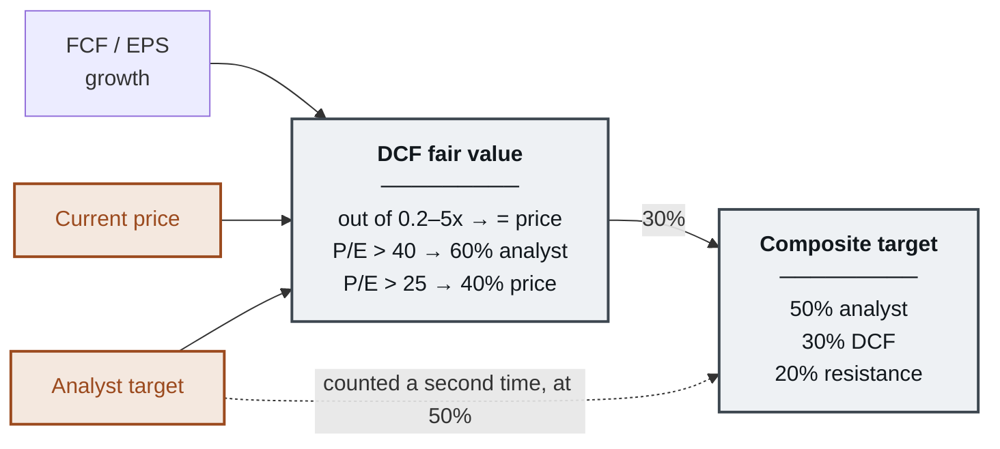
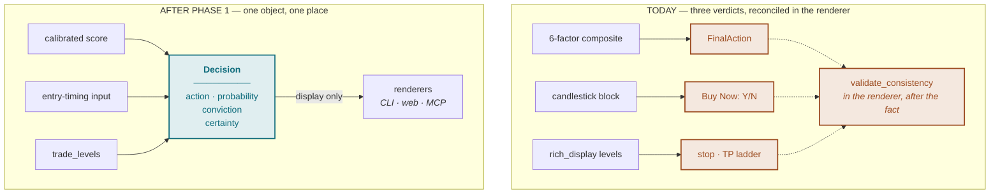
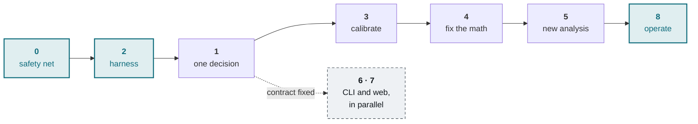

# Recalibrating QUANTA — Implementation Plan

**Target:** `core/TradingAnalysis_ELITE.py` (13,091 LOC) and its surrounding subsystems
**Status:** Phases 0 and the limited Phase 2 study implemented; Phases 1 and 3 partially implemented. Full-model validation remains open.
**Findings verified:** 27 August 2026. Line numbers reflect the file at that revision.
**Related:** `docs/PRODUCTION_READINESS_AUDIT.md` (blockers `H-08`, `H-09`, `M-06`, `M-07`), `docs/ELITE_BUGFIX_REPORT.md`

---

## Implementation Log

| Phase | Status | Commit | Result |
|---|---|---|---|
| **0 — Safety net** | ✅ Done | `85ee705` | Suite went 270 passed/19 failed/3 uncollectable → **314 passed/0 failed**. `pyproject.toml`, CI (2 jobs), 12 golden fixtures. Engine byte-identical. Golden net verified by perturbation: a 0.01 weight change surfaced as 7 changed fields. |
| **2 — Measurability** | ✅ Limited study | `2fa28d2`…`954639f` | Technical/risk components were reconstructed without look-ahead; only 40% of the live composite was testable. The study found **no demonstrated predictive power**. Full-model blocker `H-09` remains open. |
| **1 — One decision** | ◐ Partial | Working tree, 24 Sep 2026 | Shared final action now gates deep-analyzer beginner guidance, Streamlit and MCP labels. Short-term scoring is less duplicated. Scanner/deep reconciliation and all report paths still need one published decision object. |
| **3 — Calibrate** | ◐ Measurement only | Working tree, 24 Sep 2026 | SQLite ledger now records immutable full deep-analysis calls and resolves exact 5/10/30-session outcomes against matching benchmark dates. This is prospective measurement, not calibration or evidence of edge. Short-term/scanner calls are not yet wired. |
| **4 — Fix the math** | ⬜ | — | — |
| **5 — New analysis** | ⬜ | — | — |
| **6/7 — Surfaces** | ⬜ | — | — |
| **8 — Operate** | ⬜ | — | — |

Scope corrections discovered during implementation are recorded at [3.3](#33-correction-the-survivorship-machinery-is-a-stub) and [5.3](#53-phase-2--retain-the-feature-panel-then-wire-the-harness).

### 24 September 2026 continuation note

- The old `.signal_history.json` includes test-generated rows and wrong T+N prices; it is retained only as legacy position context. Do not use its win rates or the historical backtests to fit weights. New calls use `python -m tracking report` and `python -m tracking resolve` from `core/`.
- The ledger deliberately leaves a call pending when an exact entry, exit, or benchmark bar is missing. Its historical excess returns are exploratory; repeated horizons and selected universes do not establish prospective edge.
- The short-term scanner now measures nearby structural resistance instead of constructing a target to pass its own R/R gate. Null financial fields are treated as missing, and free cash flow is compared with market cap rather than rewarded by absolute company size. These are correctness repairs to an unvalidated heuristic.
- Streamlit needs **targeted improvements**, not a major revamp or full redesign: the existing research layout is usable, while decision labels, freshness, evidence status, and cache controls needed clearer treatment. The action-field shadowing defect is fixed.
- Next gates: one immutable decision record across scanner, deep analyzer, CLI, web and MCP; point-in-time fundamentals/estimates/news; realistic benchmarked validation on a survivorship-aware universe; and final portfolio invariant checks. No predictive edge is claimed.

---

## Table of Contents

1. [Executive Summary](#1-executive-summary)
2. [Defect Register](#2-defect-register)
3. [What Already Exists](#3-what-already-exists)
4. [Target Architecture](#4-target-architecture)
5. [Implementation Phases](#5-implementation-phases)
6. [Interface Plan](#6-interface-plan)
7. [Operating the Loop](#7-operating-the-loop)
8. [Getting Started](#8-getting-started)
9. [Appendices](#9-appendices)

---

## 1. Executive Summary

### 1.1 Verdict

QUANTA Elite is a well-built **data aggregator** wrapped around an **unmeasured heuristic**.

Fifteen analyzers pull genuinely good inputs — analyst consensus, insider flow, SEC filings, catalyst detection, Piotroski F-score, Altman Z-score, and a Monte Carlo simulation with Student-t fat tails and a correctly applied Itô drift correction. Then all of it collapses through roughly two hundred hardcoded thresholds into a single composite number, and **no mechanism anywhere checks whether those thresholds predict anything.**

`SignalTracker` faithfully records every signal and its realized outcome. Nothing consumes that record to adjust a single weight.

The project's own audit already names this as blocker **`H-09`** — no point-in-time out-of-sample validation of the live engine — and **`M-07`** — monolithic engines with duplicated thresholds. Both assessments are correct, and both are load-bearing for everything in this plan.

The highest-leverage change is therefore **not more indicators.** It is *closing the loop*: making the system able to measure itself, then letting the measurement set the weights. Eleven specific defects stand between here and there.

### 1.2 The Reframe

The most useful finding of the survey is how little needs to be built from scratch.

The repository already contains a rigorous walk-forward harness, a serious backtester with a realistic cost model, a data-quality validator, a unified decision core, a clean engine-to-presentation adapter, and a professionally architected typed frontend. **They are simply not connected to each other.** Roughly 3,650 lines across eight modules have zero importers.

This changes the character of the work from "rewrite the engine" to **"wire the existing parts into one calibrated loop and delete the duplicates."**

### 1.3 Scope and Method

| Dimension | Current state |
|---|---|
| Engine size | 13,091 LOC in one file |
| Analyzer classes | 15 |
| Dataclasses | ~25 |
| Independent decision paths | 3 |
| Display layer | 3,076 LOC, 353 output calls, 26 Rich panels + 11 tables in one render |
| Decision keywords in display layer | 85 occurrences |
| Orphaned module code | 3,650 LOC / 8 files |
| OOS validation of the live model | None |
| Declared dependencies | None (no `pyproject.toml` or `requirements.txt`) |
| CI for `stock-analysis` | None |

Findings were verified by direct reading of the decision, valuation, risk, sizing and orchestration paths, cross-checked against the `modules/`, `core/engine/`, `core/apex_quant/`, `tests/`, `docs/` and `ui/` trees.

---

## 2. Defect Register

Each defect carries an ID referenced by the phase that fixes it. See [Appendix A](#appendix-a--defect--phase-traceability) for the full traceability matrix.

### 2.1 Severity Summary

| ID | Defect | Severity | Fixed in |
|---|---|---|---|
| [D1](#d1--the-signal-thresholds-exist-in-three-places) | Signal thresholds declared in three places | Critical | Phase 1 |
| [D2](#d2--two-decision-engines-run-in-parallel) | Two decision engines; the visible one is less reliable | Critical | Phase 1 |
| [D3](#d3--confidence-is-signal-strength-wearing-the-wrong-name) | Confidence conflated with signal strength | Critical | Phase 1 |
| [D4](#d4--the-dcf-is-anchored-to-the-price-it-exists-to-challenge) | DCF anchored to the price it should challenge | Critical | Phase 4 |
| [D5](#d5--kelly-is-computed-displayed-and-never-used) | Kelly computed on a hardcoded payoff, never used | Moderate | Phase 4 |
| [D6](#d6--the-position-size-clamp-runs-before-two-more-multipliers) | Size clamp runs before two more multipliers | Critical | Phase 4 |
| [D7](#d7--every-forward-looking-number-rests-on-an-unshrunk-trailing-mean) | Forward estimates rest on an unshrunk trailing mean | Critical | Phase 4 |
| [D8](#d8--missing-data-is-silently-scored-as-neutral) | Missing data silently scored as neutral | Moderate | Phase 2 |
| [D9](#d9--cliff-edge-scoring-on-absolute-thresholds) | Cliff-edge scoring on absolute thresholds | Moderate | Phase 3 |
| [D10](#d10--correlated-indicators-counted-as-independent-evidence) | Correlated indicators counted as independent | Moderate | Phase 3 |
| [D11](#d11--no-global-deadline-and-the-same-symbol-fetched-five-times) | No global deadline; redundant fetches | Moderate | Phase 4 |

---

### D1 — The signal thresholds exist in three places

**Severity:** Critical

The 75 / 65 / 55 / 45 ladder is declared three separate times:

| Location | Form |
|---|---|
| `core/TradingAnalysis_ELITE.py:236` | `Config.SIGNAL_CUTOFFS` |
| `core/TradingAnalysis_ELITE.py:4873–4899` | Hardcoded `if composite >= 75 … elif` chain inside `SignalGenerator.generate` |
| `core/engine/decision_engine.py:22–28` | `_BUY_THRESHOLDS` |

Tuning one leaves the other two behind, and the summary silently disagrees with the detail. This is audit item `M-07`.

---

### D2 — Two decision engines run in parallel

**Severity:** Critical
**This is the most user-damaging defect in the system.**

The headline signal comes from the six-factor composite, resolved through `resolve_final_action` (`ELITE:7425`).

But the field the user actually acts on — **Buy Now / Timing / Entry Quality** — is produced by `_compute_beginner_guidance` (`ELITE:9524`), and lines `9549–9617` derive that verdict **purely from candlestick patterns, MACD, the 50-day average and volume. It never consults `result.signal` at all.**

Consequence: a composite of 78 that has cleared every override can display `Buy Now: NO` because a doji printed after an uptrend. The single most actionable field on the screen is driven by the least reliable input in the system.

Compounding this:

- `validate_consistency` is called from **inside `display_analysis`** (`ELITE:9920`) — a reconciliation pass in the renderer, executed after both answers already exist.
- A **third** set of trade logic (ATR stop, entry zones, take-profit ladder, R:R gate, WAIT detection, upgrade triggers) lives in `core/rich_display.py`, which is not even an importable module — it is a source fragment spliced into the monolith.

---

### D3 — Confidence is signal strength wearing the wrong name

**Severity:** Critical

`ELITE:5311` sets `confidence = composite`.

These are different quantities. One is *how strong the call is*; the other is *how much the estimate can be trusted*. A composite of 50 computed from complete data reports confidence 50. A composite of 80 computed with three feeds missing reports 80.

Five override blocks then mutate the value in sequence using a mix of `min(confidence, X)` and `max(X, confidence - Y)`:

```
ELITE:4947   confidence = min(confidence, 45)
ELITE:4960   confidence = max(30, confidence - 20)
ELITE:4971   confidence = max(35, confidence - 15)
ELITE:4990   confidence = max(35, confidence - 15)
ELITE:5015   confidence = max(35, confidence - 15)
```

Because the operators are mixed, the final value depends on the order the blocks happen to be written in, and the cascade is not idempotent.

---

### D4 — The DCF is anchored to the price it exists to challenge

**Severity:** Critical

Three substitution rules inside `_calculate_dcf` pull the market price and the analyst target into the supposedly independent intrinsic value:

| Line | Rule | Effect |
|---|---|---|
| `4334–4338` | Result outside 0.2×–5× price → **replaced by** current price | DCF *is* the price |
| `4345–4352` | P/E > 40 → 40% DCF + **60% analyst target** | DCF is mostly consensus |
| `4354–4358` | P/E > 25 → 60% DCF + **40% current price** | DCF is 40% price |

Then `calculate_composite_targets` (`4405–4418`) weights that already-contaminated DCF at 30% **alongside the analyst target at its own 50%.**



**Consequence:** the composite target cannot meaningfully disagree with the market. This is why the target-discipline override at `4980` so rarely bites. Both highlighted paths must be cut for the three legs of the target to be three actual legs.

Alongside it, two smaller fabrications:

- `target_conservative = base * 0.90` and `target_aggressive = base * 1.15` (`4442–4445`) — fixed bands, identical for a utility and a biotech, unrelated to the security's actual volatility.
- `target_confidence = len(targets) * 25` (`4448`) — three sources yields "75% confidence". Invented outright.

---

### D5 — Kelly is computed, displayed, and never used

**Severity:** Moderate

```python
# ELITE:5658–5659
reward_per_share = abs(entry * 0.15) if signal in [STRONG_BUY, BUY] else abs(entry * 0.10)
win_loss_ratio  = max(1.5, reward_per_share / risk_per_share)
```

Three problems in two lines:

1. The price target that an entire analyzer computed is **discarded** and replaced with a flat 15%.
2. `max(1.5, …)` **floors the payoff**, so Kelly can never see an unfavourable trade.
3. `kelly_optimal` is stored (`5665`), serialized into the MCP payload (`11587`), shown to the user — and **never touches the share count**, which comes solely from `dollar_risk / risk_per_share` (`5669`).

Displaying a number the system ignores is worse than not computing it.

---

### D6 — The position-size clamp runs before two more multipliers

**Severity:** Critical

```
ELITE:5626   adjusted_risk = max(0.005, min(0.06, adjusted_risk))   # clamp to 6%
ELITE:5631   adjusted_risk *= grade_mult      # A-grade → 1.2
ELITE:5650   adjusted_risk *= drawdown_mult
```

The clamp is applied *before* the two multipliers, so an A-grade name can be sized at **7.2% of account risked on a single trade** — several times standard practice. The base risk of 4% for a `STRONG_BUY` is already high before any multiplier lands.

**Additionally, the drawdown scaler is dead code.** `ELITE:5636` reads:

```python
portfolio_drawdown = getattr(risk, 'portfolio_drawdown', 0)
```

`RiskMetrics` (`ELITE:539–586`) defines no such field. The value is always `0`, so the branch its own comment calls *"a critical risk management feature missing from the original"* has never once executed.

---

### D7 — Every forward-looking number rests on an unshrunk trailing mean

**Severity:** Critical

`ELITE:2957`:

```python
result.expected_return = returns.mean() * 252
```

On one year of daily data this estimate carries a standard error roughly equal to the stock's own annual volatility — a **±60% 95% interval** for a 30%-vol name. It is capped at ±25% (`4499`) but **never shrunk toward a prior.**

It then propagates through the entire forward-looking machinery:

```
expected_return (±60% error)
  → Monte Carlo drift (4496–4507)
    → probability_profit
      → win probability, at 70% weight (5783–5788)
        → Kelly criterion
      → R/R asymmetry override (4963)
```

**Net effect:** recent winners inherit inflated forward probabilities *because* they are recent winners. This is momentum extrapolation entering through the risk model rather than the signal model, where nobody is looking for it.

Two smaller errors sit alongside:

- **Beta ddof mismatch** (`2934–2938`): divides an `np.cov` result (ddof=1) by an `np.var` result (ddof=0). Beta is also neither Blume- nor Vasicek-shrunk, while feeding *both* the DCF discount rate and the position-size cap divisor.
- **Volatility percentile NaN denominator** (`2916`): counts the 19 leading NaNs of `rolling(20)` in the denominator, biasing every percentile low by roughly seven points.

---

### D8 — Missing data is silently scored as neutral

**Severity:** Moderate

Every indicator reads only `.iloc[-1]` and substitutes a hardcoded neutral on NaN (`ELITE:1573`, `1584–1590`, and throughout). A stock with thin history scores 50, which the composite reads as *"balanced"* rather than *"unknown"*.

The data-quality note then tries to infer missingness from the value itself (`ELITE:5035`):

```python
data_sources = sum(1 for s in score_values if s != 50.0)  # Non-default scores
```

So a component that legitimately computes to exactly neutral is misreported as a missing feed.

---

### D9 — Cliff-edge scoring, on absolute thresholds

**Severity:** Moderate

`_calculate_component_scores` (`ELITE:5119–5279`) is roughly 150 lines of:

```python
if technical.rsi < 30:   tech_score += 15
elif technical.rsi < 40: tech_score += 8
elif technical.rsi > 70: tech_score -= 15
```

Three distinct problems:

1. **Discontinuity.** RSI 29.9 versus 30.1 moves the technical score seven points.
2. **Absolute thresholds.** `roe > 20 → +15` structurally rewards asset-light software and structurally penalizes utilities and banks. Nothing is relative to sector or size.
3. **Mixed paradigms.** The same block treats oversold as bullish (mean reversion) and a strong ADX uptrend as bullish (trend following), without separating the regimes in which each actually holds.

---

### D10 — Correlated indicators counted as independent evidence

**Severity:** Moderate

`_count_confirmations` (`ELITE:5091–5104`) tallies these as five separate confirmations:

- `macd_signal == "BULLISH"`
- `price_vs_sma200 > 0`
- `golden_cross`
- `obv_trend == "BULLISH"`
- `trend_direction`

These are five nearly collinear reads of the same underlying momentum. The tally then gates the `STRONG_BUY` threshold (`5322`). Conviction is therefore systematically overstated in exactly the trending names where all five agree *by construction* — a textbook pseudo-replication error.

---

### D11 — No global deadline, and the same symbol fetched five times

**Severity:** Moderate

**Timeouts do not bound the request.** `ELITE:7880–7885` calls `future.result(timeout=30)` sequentially over seven futures. Each timeout is measured from when `.result()` is called, not from submission, so the worst case is **7 × 30 = 210 seconds**, not 30. Fast mode is 3 × 8 = 24 seconds, not 8.

`shutdown(wait=False, cancel_futures=True)` cannot cancel threads already running, so hung sockets accumulate in any long-lived process (Streamlit, Flask, MCP server).

**The same symbol is fetched five times.** Five analyzers each construct their own `yf.Ticker(ticker)`, each triggering an independent and slow `.info` scrape:

| Line | Analyzer |
|---|---|
| `2471` | `FundamentalAnalyzer` |
| `3350` | `SentimentAnalyzer` (Yahoo news) |
| `3549` | `MarketIntelligenceAnalyzer` |
| `3711` | `InsiderAnalyzer` |
| `3911` | `CatalystAnalyzer` |

`CacheManager` covers only the price frame (`7596`). `main()` re-fetches the entire market environment inside the per-ticker loop (`13014`). Across the repo there are **nine unrelated ad-hoc caches** and no cross-run persistence on the main analysis path.

---

## 3. What Already Exists

### 3.1 Inventory of Unwired Assets

| Asset | LOC | What it does | Status |
|---|---|---|---|
| `core/apex_quant/` | 1,593 | Walk-forward with train → strictly-later test folds, params tuned on train only, concatenated OOS curve, three baselines it must beat (buy-and-hold SPY, random entry, random exit). Parquet disk cache with SHA-256 run hashing. Conservative same-bar labeling (stop fills first). | Validates its own parametric strategy. **Never sees the ELITE composite.** |
| `modules/robust_backtesting_engine.py` | 1,135 | Commission, slippage and market impact; 5%-of-ADV liquidity caps, partial fills, 10k-run Monte Carlo, time-series CV, autocorrelation-adjusted Sharpe, MAE/MFE. | **Zero importers. Dead.** |
| `modules/data_quality_validator.py` | 860 | OHLC relationship checks, stuck prices, extreme returns, zero-volume runs, corporate-action detection, 0-100 quality score. ⚠️ Its survivorship-bias handling is a **stub** — see [3.3](#33-correction-the-survivorship-machinery-is-a-stub). | **Zero importers.** Wired in Phase 2 as a quality gate. |
| `core/engine/` | 945 | The shared decision core, written expressly so the scanner and the analyzer cannot disagree. Position-aware `FinalAction`, one override resolver, one risk grade, a consistency validator. | Partially adopted. ELITE still keeps its own ladder and five override blocks. |
| `ui/alphalens/web/` | 11,400 | Next.js 15 / React 19 / TypeScript strict, 24 design primitives (`ScoreRing`, `Meter`, `Sparkline`, `ProvenanceBadge`), a 654-line typed API contract, TanStack Query, vitest + Playwright, working CI. | Complete shell, **fed by a synthetic demo provider.** |
| `core/streamlit_support.py` | 704 + 284 tests | A pure, tested adapter that already converts raw engine output into presentation-ready structures. | Serves only the Streamlit shell. |
| `modules/polymarket_provider.py` | 544 | Prediction-market probabilities for Fed decisions, recession odds, per-ticker earnings. Free API, no auth. | **Zero importers. Dead.** |
| `modules/entry_optimizer.py` | 370 | Anti-momentum-chasing entry timing: gap-up rejection, pullback waiting, cascading limit orders. | **Zero importers. Dead.** |
| `modules/earnings_revision_scoring.py` | 275 | EPS-revision breadth — one of the better-documented equity factors. Returns neutral on failure. | Used by `SP_ELITE_PRO`. **Not by ELITE.** |

### 3.2 The Central Architectural Fact

> **AlphAlens is the right architecture with the wrong engine.** Its only data adapter is a synthetic demo provider.
>
> **The `core` tree is the right engine with the wrong architecture.** 24,000 lines of real analytics behind a 13,000-line monolith, five conflicting stylesheets and a hand-rolled 5,477-line DOM renderer.
>
> **Port the engine to the architecture, not the architecture to the engine.**

That single direction of travel decides Phase 7 and saves the larger half of the UI work.

### 3.3 Correction: the survivorship machinery is a stub

The inventory above was originally compiled from module **API surfaces**. On reading the implementations during Phase 2, one entry proved overstated, and is corrected here rather than quietly left standing.

`modules/data_quality_validator.py` does **not** provide survivorship-bias correction, despite docstrings that describe it:

| Claimed capability | Actual implementation |
|---|---|
| Historical index constituents | `get_historical_sp500_constituents()` logs *"Using current S&P 500 constituents as historical data not available"* and returns `[]` |
| Delisted-stock database | Two hardcoded entries (`SHLD`, `GE`); `data/delisted_stocks.json` does not exist |
| Historical S&P 500 database | `data/sp500_historical.json` does not exist; the loader returns `{}` |

What *is* implemented and genuinely useful: OHLC relationship validation, stuck-price detection, extreme-return detection, zero-volume runs, missing-data gaps, and a 0-100 quality score. It is wired in Phase 2 as a panel gate.

**Consequence:** the survivorship caveat in `core/apex_quant/universe.py` stands in full, and every backtest number carries it. Closing that gap needs a point-in-time membership vendor (CRSP, or Sharadar SF1 with delisting flags) and is a procurement decision, not an engineering one — added to [Appendix C](#appendix-c--decisions-required-before-starting).

### 3.4 Blocking Housekeeping

Two facts gate everything, and both are cheap to fix:

1. **Five test files are silently dead.** `test_market_regime.py`, `test_market_intel.py`, `test_scan_health.py`, `test_webapp_input_validation.py` and `test_provider_resilience.py` all bootstrap `sys.path` to `../webapp`, which no longer exists — the app moved to `ui/stock-analysis/webapp/` in commits `1af5106` / `b461881`. The launchers were repointed in `35a18b8`; the tests were not. **1,226 lines of coverage are inert.**
2. **`pytest` is not installed** in `stock-analysis/.venv`, so the 5,100-line suite cannot be run as a suite at all — only file-by-file via `unittest.main()`. There is **no CI** for `stock-analysis`.

---

## 4. Target Architecture

### 4.1 Three Decision Paths Collapse Into One



The three inputs survive. What disappears is **their independent authority to issue a verdict.** Candlestick timing becomes an entry-timing modifier on the single decision rather than a competing answer — it can say "wait for confirmation" but it can no longer contradict the decision. The reconciliation pass in the renderer can then be deleted, because there is nothing left to reconcile.

### 4.2 The `Decision` Object

One serializable object, produced in the engine, consumed by every surface:

| Field | Meaning | Replaces |
|---|---|---|
| `action` | Position-aware `FinalAction` (BUY / ADD / HOLD_EXISTING / TRIM / WATCHLIST) | `Signal` enum + display-layer relabeling |
| `probability` | Calibrated `P(outperform benchmark)` with interval, per horizon | `composite_score` |
| `conviction` | Signal strength | `confidence_score` (first half) |
| `certainty` | Estimate quality: data completeness, component dispersion, provider agreement | `confidence_score` (second half) |
| `attribution` | Per-factor contribution in probability points | `ScoreBreakdown` |
| `levels` | Entry zone, stop, TP ladder, size, R:R — from `engine/trade_levels.py` | Logic in `rich_display.py` + `TradeSetupGenerator` |
| `reasons` | Ordered, structured explanation | `SignalExplanation` + `overrides_triggered` |
| `provenance` | Per-field source, timestamp, `is_missing` | (nothing) |

**Invariant:** no decision keyword — `Signal.`, `signal ==`, `composite`, `confidence` — appears anywhere in the display layer. There are 85 such occurrences today.

---

## 5. Implementation Phases

### 5.1 Dependency Sequence

> **You cannot improve accuracy you cannot measure.**

That constraint sets the order. The measurement harness has to run against the live model *before* any weight is touched, or every subsequent change is a guess dressed as an improvement. So the phases **do not run in numeric order** — the harness comes second, and the cleanup that feels most urgent comes third.



Phases 0 and 2 exist only to make change verifiable; they alter no behaviour. Phase 1 fixes the shape of the output contract, which is what lets the two surface phases proceed independently of the modelling work in 3 through 5.

---

### 5.2 Phase 0 — Make Change Safe

**Goal:** no behaviour changes at all. This phase exists so that every later phase can prove it did what it claimed.

#### Tasks

- **Declare dependencies.** Add `pyproject.toml`. The project currently declares none anywhere, despite a *hard* import of `ta` at `ELITE:156–160`. Copy the tooling discipline from the sibling `alphalens/` project, which already has a working `pyproject.toml`, `Makefile`, `docker-compose.yml` and CI workflow.
- **Make the suite runnable.** Install `pytest` into the venv. Add a `conftest.py` with shared fixtures to replace the per-file `sys.path` bootstrapping that all 24 test files currently repeat.
- **Recover dead coverage.** Repoint the five broken web-app test files from `../webapp` to `../../ui/stock-analysis/webapp`, recovering 1,226 lines.
- **Add CI.** A workflow that actually runs the suite. Also fix or delete `.github/workflows/build_exe.yml`, whose PyInstaller target is missing the `.py` extension.
- **Build the golden master.** Freeze the full serialized result (`_mcp_result_to_dict`) for ~40 tickers chosen to span the failure surface:

  | Cohort | Purpose |
  |---|---|
  | Mega-cap US | Baseline happy path |
  | Small-cap, thin coverage | Analyst-count and thin-coverage paths |
  | ETF | `is_etf` branch, expense ratio, net assets |
  | ADR / `.L` / `.NS` suffix | Suffix probing, currency symbol |
  | Thin price history (< 50 bars) | `MIN_DATA_POINTS` gate, NaN neutral substitution |
  | Negative earnings | DCF `EARNINGS_BASED` / `FAILED` paths |
  | High P/E (> 40) | Both DCF anchor branches |
  | Recently split | `SPLIT_ARTIFACT_RETURN_THRESHOLD` sanitization |
  | No analyst coverage | Target-blend renormalization |
  | Risk grade D and F | Override cascade |

  **Record every network response to fixtures** so the suite is deterministic and offline.

#### Exit Criteria

- [ ] The whole suite runs green **offline**, in one command, in CI.
- [ ] Any diff in those 40 outputs is visible and must be explained.

> Refactoring 13,000 lines without this is gambling.

---

### 5.3 Phase 2 — Retain the Feature Panel, Then Wire the Harness

**Goal:** make the model measurable. **Fixes:** `D8`.

The reason the model has never been validated is mechanical: every indicator computes a full series and then keeps only `.iloc[-1]`. Without the history there is nothing to replay, so no backtest of the scoring model is possible. Fixing that one thing unlocks everything downstream.

#### Tasks

- **Retain series.** `TechnicalAnalyzer.analyze` returns a date-indexed `FeatureFrame`, one column per feature, with a `.latest` view so existing callers keep working.
- **Point-in-time fundamentals.** As-reported, so restatements cannot leak backwards into a historical evaluation.
- **Explicit missingness.** Every feature carries `(value, timestamp, source, is_missing)`. This is the structural fix for **`D8`** — missing stops being indistinguishable from neutral, and the data-quality note stops inferring absence from the literal value `50.0`.
- **Wire the orphaned validator.** Connect `modules/data_quality_validator.py` (860 LOC, currently dead) as a panel quality gate. ⚠️ Scope correction after reading the implementation: this delivers the OHLC/stuck-price/extreme-return checks but **not** survivorship-bias correction, which is a stub — see [3.3](#33-correction-the-survivorship-machinery-is-a-stub).
- **Adopt conservative labeling.** Use `core/apex_quant/labeling.py`'s same-bar rule: when a bar's range touches both stop and target, assume the **stop** filled first.
- **Point the harness at the live model.** Connect `core/apex_quant/walkforward.py` to the ELITE composite instead of only its own parametric strategy. It already provides:
  - Train → strictly-later test folds
  - Parameter selection on train data only
  - One concatenated, honestly out-of-sample equity curve
  - Three baselines the strategy must beat: **buy-and-hold SPY, random entry, random exit**
  - Multiple-testing control via a deliberately tiny grid and one-touch held-out evaluation

#### Exit Criteria

- [x] A reproducible OOS report for the reconstructable technical/risk portion, stamped with the SHA-256 run hash `apex_quant/data_provider.py` already emits. This covers about 40% of the live composite.
- [ ] Audit blocker **`H-09` closed.** The full live decision still lacks point-in-time, survivorship-aware OOS validation.

Artifacts: `core/apex_quant/_reports/elite_oos.{json,txt}`, `elite_walkforward.txt`, and `elite_panel.parquet` (32,825 scored rows, reused by Phase 3).

Reproduce with:

```bash
python -m core.apex_quant.run elite-oos --end 2026-08-27 --eval-every 5   # ~30 min
python -m core.apex_quant.run elite-walkforward --start 2014-01-01        # ~1 min
```

### 5.3.1 Phase 2 result: the composite has no demonstrated edge

Two independent instruments, one conclusion.

**Cross-sectional information coefficient** — 42 tickers, 32,825 observations, 2010-12-30 to 2026-08-25, weekly scoring:

| Horizon | Mean IC | t | Q5−Q1 | t(Q5−Q1) | Q5<Q1 on |
|---|---|---|---|---|---|
| 21d | −0.0225 | −1.41 | −0.58% | −1.93 | 55.1% of dates |
| 63d | −0.0339 | −0.96 | −1.15% | −1.95 | 54.8% of dates |

Neither IC t-statistic clears |t| > 2, so **"the score is inverted" is not a supportable claim.** What *is* supported: no evidence of predictive power, plus a persistent negative tilt corroborated by a **perfectly monotone decreasing** bucket profile at both horizons (21d: 1.51% → 1.38% → 1.35% → 1.23% → 0.93%; 63d: 4.40% → 4.19% → 4.01% → 3.78% → 3.25%), across 6,272 observations per bucket.

**Which leg does the damage** — this is the actionable part:

| Input | IC 21d | IC 63d | Reading |
|---|---|---|---|
| `annualized_volatility` | **+0.0734** | **+0.1387** | Strongest signal in the panel |
| `beta` | **+0.0630** | **+0.1231** | Same effect |
| `score_risk` | −0.0447 | −0.0966 | **An inverted transform of the above** |
| `composite` | −0.0225 | −0.0339 | Dragged down by `score_risk` |
| `rsi` | +0.0128 | +0.0134 | Mild |
| `adx` | +0.0040 | +0.0123 | Negligible |
| `score_technical` | −0.0069 | −0.0004 | **≈ zero. 30% of model weight, ~150 lines of thresholds** |

Two conclusions:

1. **`score_technical` has no predictive power at all** (−0.0069 / −0.0004). This is the cleanest finding in the report and the least contaminated by universe bias, because it is not a beta proxy. Roughly 150 lines of hand-tuned thresholds carrying 30% of model weight produce no measurable signal.
2. **`score_risk` is negatively predictive by construction.** `score_risk = 100 − risk_score×10` inverts volatility, and volatility is the most positively-related variable in the panel. The engine takes its strongest available input and flips its sign. This is an architectural error, not a tuning error: **volatility belongs in position sizing, not in a return-ranking score.** A low-volatility utility should be sized *larger*, not ranked *higher* for expected return. The composite currently conflates "desirable risk profile" with "expected return."

⚠️ **Do not read the +0.14 volatility IC as tradeable alpha.** Over 2010–2026 in a *static present-day* large-cap universe, high-beta survivors outperform partly because the names that blew up were never in the list ([3.3](#33-correction-the-survivorship-machinery-is-a-stub)). The defensible claim is narrow: within this survivor universe volatility related positively to return, so `score_risk`'s sign is doing real damage.

**Walk-forward trade simulation** — 9 folds, OOS 2017-01-01 to 2026-01-01, costs applied:

| | CAGR% | Sharpe | Sortino | MaxDD% | Trades | Hit% | PF | Alpha% |
|---|---|---|---|---|---|---|---|---|
| **ELITE composite** | 0.76 | 0.12 | 0.16 | 24.43 | 1,014 | 37.5 | 1.02 | −2.56 |
| Buy & hold SPY | 11.41 | 0.66 | 0.79 | 34.10 | 1,760 | 54.7 | 1.14 | −0.01 |
| Random entry | −0.15 | −0.02 | −0.02 | 10.21 | 130 | 30.8 | 0.99 | −0.38 |
| Random exit | **4.70** | **0.43** | **0.55** | 21.08 | 1,034 | 46.3 | 1.13 | **+1.86** |

The harness's bar is beating all three. The composite beats one, marginally.

The damning row is **random exit**: keeping the strategy's own entry dates but *randomizing* the stop and target multiples produced **6× the CAGR and 3.6× the Sharpe**, and turned −2.56% alpha into +1.86%. That baseline exists precisely to detect a strategy whose exit rule adds nothing, and it fired.

Parameter selection was stable (`atr_stop_mult` = 1.5 chosen in 8 of 9 folds), so this is not overfitting instability. The consistent selection of the grid's *tightest* stop while a randomized stop beats it points at the underlying cause: **with no edge in the entry signal, selecting exit parameters on training Sharpe is fitting noise.** A 37.5% hit rate against a tight stop means the strategy is repeatedly stopped out.

**Consequence for the plan.** Phase 3 was scoped as "let the data set the weights." The result argues for something stronger: reweighting a set of components in which one is empirically null and another is sign-inverted will not produce a good model. Phase 3 should additionally
(a) remove volatility and beta from the return score and route them to sizing, and
(b) treat `score_technical` as unproven and rebuild it from features with measured IC rather than re-tuning the existing thresholds.

This is exactly the "be prepared for the answer to be no" case the phase was designed to surface.

---

### 5.4 Phase 1 — One Decision, Produced in One Place

**Goal:** settle the output contract the new surfaces will be typed against. **Fixes:** `D1`, `D2`, `D3`.

#### Tasks

- **Single threshold source.** Delete the hardcoded ladder from `SignalGenerator.generate` (`4873–4899`). `engine/decision_engine.py` becomes the only resolver and *reads* `Config.SIGNAL_CUTOFFS` rather than declaring its own `_BUY_THRESHOLDS`.
- **Declarative override cascade.** Move all five override blocks into `engine/risk_overrides.py` as an **ordered list of pure functions**, each with signature `(state) -> (state, Reason)`. The cascade becomes declarative, individually testable, idempotent, and *explicit* about its ordering instead of accidentally dependent on it.
- **Extract trapped trade logic.** Move ATR stop, entry zones, take-profit ladder, R:R gate, WAIT detection and upgrade triggers out of `core/rich_display.py` into `engine/trade_levels.py`. Then delete `core/update_display.py` and `core/update_market.py` (dead splice scripts with hardcoded `c:/Projects/...` paths) and the three duplicate `from rich.console import Console` blocks at `ELITE:8391`, `8401`, `9260`.
- **Demote the candlestick block.** `_compute_beginner_guidance` stops deriving a verdict and becomes a renderer of the one `Decision`. Pattern timing survives as an **entry-timing modifier** — it can say "wait for confirmation" but it cannot contradict the decision.
- **Split confidence in two.** `conviction` for signal strength; `certainty` for estimate quality, driven by data completeness, component dispersion and cross-provider agreement.

#### Exit Criteria

- [ ] `validate_consistency` passes for all 40 golden tickers **by construction**, and the call is removed from the renderer.
- [ ] Zero decision keywords in the display layer (from 85).
- [ ] Audit item **`M-07` closed.**

---

### 5.5 Phase 3 — Let the Data Set the Weights

**Goal:** replace hand-tuned heuristics with a fitted, calibrated model. **Fixes:** `D9`, `D10`.

#### Tasks

- **Continuous, cross-sectional features.** Replace every cliff threshold with a monotone transform, then normalize **cross-sectionally**: each raw feature becomes a percentile within a sector-and-size cohort *before* it becomes a score. This kills the discontinuity and the structural sector bias in one move — a 12% ROE stops being punished for belonging to a utility.
- **Fit the composite.** Train on the Phase 2 panel with **purged and embargoed walk-forward cross-validation**. Start with logistic regression, because its coefficients *are* the new weights and stay legible. Run gradient boosting as a challenger; ship whichever wins out of sample, preferring the simpler on a tie.
- **Two explicit horizons.** Predict `P(forward return > benchmark)` at **21 and 63 days**. This also resolves a mismatch nobody has named: the price target is a twelve-month blend while the stop is an ATR measured in days.
- **Calibrate.** Apply isotonic regression so a stated 70% actually resolves near 70%. Report the reliability curve as a first-class output.
- **Fix the confirmation count.** Replace `_count_confirmations` with an **effective-independent-signal count** (eigenvalue-based, or simply collapse to one momentum factor), so five collinear reads stop counting as five pieces of evidence.
- **Fit the regime weights.** `Config.REGIME_WEIGHTS` becomes fitted per-regime coefficients, shrunk toward the pooled fit so thin regimes cannot overfit.
- **Keep the baseline.** The hand-tuned scorer stays available behind a flag, as the thing the fitted model must beat.

#### Exit Criteria

- [ ] The fitted model beats the current heuristic **and all three harness baselines** out of sample.
- [ ] The reliability curve is close to the diagonal.

> If it does not beat them, that is a finding worth having, and the heuristic stays.

---

### 5.6 Phase 4 — Fix the Specific Math

**Goal:** correct the identified numerical defects. **Fixes:** `D4`, `D5`, `D6`, `D7`, `D11`.

Each item is small and independently testable against the golden master.

#### 5.6.1 Estimation (`D7`)

- **Shrink the return estimate.** Shrink `expected_return` toward its CAPM prior (`rf + β·ERP`), weighted by estimation error, instead of merely capping it at ±25%.
- **Shrink beta.** Vasicek or Blume shrinkage toward 1.0. Fix the `ddof` mismatch between the `np.cov` and `np.var` terms.
- **Fix the volatility percentile.** Exclude the 19 leading NaNs of the rolling window from the denominator.
- **Prefer implied to realized volatility** wherever an option chain exists. It is free through the existing provider and it is *forward-looking* rather than backward-looking. Feeds the Monte Carlo diffusion, a horizon-matched vol from the term structure, and the implied earnings move.

#### 5.6.2 Valuation (`D4`)

- **Cut both price anchors and the analyst blend** out of the DCF.
- **Abstain honestly.** When the model is unreliable, report it as unreliable with a wide interval rather than quietly substituting the current price. An honest abstention is worth more than a fabricated agreement.
- **Scale the bands by volatility.** Replace fixed ±10% / +15% with horizon-matched vol.
- **Replace the invented confidence.** `len(targets) * 25` becomes the actual dispersion across the legs.

#### 5.6.3 Sizing (`D5`, `D6`)

- **Feed Kelly real inputs.** The real target and the real stop. Remove the `max(1.5, …)` floor. Then either *use* it as a cap on the risk-budget size, or delete it.
- **Move the clamp last.** Apply the 6% ceiling *after* every multiplier, so the stated ceiling is the actual ceiling. Reconsider whether 4% base risk on a `STRONG_BUY` is defensible at all.
- **Resolve the dead scaler.** Give `RiskMetrics` a real `portfolio_drawdown` fed from tracked positions, or delete the branch.

#### 5.6.4 Latency (`D11`)

- **One global deadline** across the whole parallel block via `concurrent.futures.wait`, replacing seven independent per-future timeouts.
- **One `.info` fetch per analysis**, shared across analyzers behind the cache.
- **Hoist the market-environment fetch** out of the per-ticker loop in `main()`.
- **Consolidate nine ad-hoc caches** onto one persistent store, generalizing the parquet pattern `apex_quant` already uses, so a repeated analysis is instant.
- **Route prices through `HybridDataProvider`** so the Polygon import stops being decorative — it is imported and reported as available today while the actual fetch path calls yfinance directly.

#### Exit Criteria

- [ ] Every golden-master diff explained.
- [ ] Worst-case wall-clock for one analysis bounded and measured.
- [ ] Phase 2 OOS report re-run, confirming the fixes **helped** rather than merely changed things.

---

### 5.7 Phase 5 — Genuinely New Analysis

**Goal:** add information, not indicators. Ranked by **information gain per unit of work.** The first three are close to free — two are already written, the third is one additional fetch.

| # | Addition | Rationale |
|---|---|---|
| 1 | **Options-implied surface** — IV rank, term structure, skew, implied earnings move | The largest real gain available. Every input in the system today is backward-looking; this is the market's own forward estimate. Free via the existing provider. |
| 2 | **Cross-sectional percentiles** | Every metric relative to a sector-and-size cohort rather than an absolute threshold. Also the fix for `D9`, so it pays twice. |
| 3 | **Earnings-revision breadth** | Already written in `modules/earnings_revision_scoring.py`, already used by `SP_ELITE_PRO`, not used here. A well-documented factor, free to adopt. |
| 4 | **Earnings quality** — Sloan accruals, Beneish M-score | Computed from statements the system already downloads. Piotroski and Altman are present; this completes the set. |
| 5 | **Factor decomposition** | Regress returns on market, size, value, momentum, quality to explain *why* a name moves and flag crowded exposures. Needs only the return series already in hand. |
| 6 | **Scenarios instead of point targets** | Bull / base / bear with explicit probabilities and named drivers, replacing a single blended number whose error bar is currently invented. |
| 7 | **Event study** | This name's own post-earnings drift and historical reaction to surprises, rather than a generic catalyst flag. |
| 8 | **Prediction-market probabilities** | `modules/polymarket_provider.py` — 544 lines already written and orphaned, free API, no auth. Genuinely differentiated macro and event odds. |
| 9 | **Entry optimization** | `modules/entry_optimizer.py` — 370 lines already written and orphaned. Gap-up rejection, pullback waiting, cascading limits. Improves realized fills, which is real money independent of signal quality. |
| 10 | **Regime-conditional history** | How this name has behaved in the regime it is in *now* — which the system already classifies but never looks back through. |

#### Exit Criteria

- [ ] Each addition admitted **only if it improves the Phase 2 OOS report.**

> A feature that does not earn its place gets removed, not kept for completeness. The current system's problem is precisely that nothing has ever had to earn its place.

---

## 6. Interface Plan

### 6.1 Current State

Six UI surfaces across three frameworks, all fronting the same engines.

| Surface | Size | Assessment |
|---|---|---|
| Terminal (`display_analysis`) | 3,076 LOC | 26 Rich panels + 11 tables in **one** render. 341 raw `print()` mixed with 30 `console.print()`. 195 emoji carrying meaning. Blocking `input()` loop, no argparse, no batch mode, no export. |
| Flask web app | `app.py` 4,254 · `app.js` 5,477 · CSS 11,521 across 5 files | Highest functionality, worst structure. **Three competing design idioms** (neumorphism / liquid glass / "elite pro") layered on one page. Genuinely good infrastructure underneath. |
| AlphAlens Next.js | ~11,400 LOC | Best architecture, zero real data. 24 typed primitives, 654-line API contract, working CI. |
| Streamlit | 849 + 704 adapter | Best-written UI code, weakest framework. Has a full `@media print` stylesheet for letter-portrait PDF export — genuinely uncommon, worth preserving. |
| Rich display fragments | 646 + 76 | Not importable modules. Source fragments containing real business logic. |
| MCP server | 1,719 | 12 tools. Consumes `_mcp_result_to_dict`. |

The consolidation matters as much as any new screen.

---

### 6.2 Phase 6 — A CLI That Respects the Terminal

#### Tasks

- **Real argument parsing.** Typer or argparse:

  ```
  quanta analyze AAPL
  quanta scan --watchlist tech.txt
  quanta compare AAPL MSFT NVDA
  quanta repl                          # the old input() loop, made explicit
  ```

  With `--json`, `--brief`, `--deep`, `--explain`, `--horizon 21d`, `--ascii`. **Non-interactive by default** so it is scriptable.

- **Progressive disclosure.** Default output is **one screen**: the verdict, its certainty, the position size, entry / stop / target, three reasons, two risks. `--deep` is where the current 26 panels go.

  > This is the entire fix. The information is good; the dump is not.

- **One renderer.** Rich throughout, retiring the 341 raw `print()` calls. Emoji optional via `--ascii` and terminal capability detection rather than load-bearing.

---

### 6.3 Phase 7 — The Web App: Answer, Then Evidence, Then Machinery

#### Strategy

Build the **existing AlphAlens frontend** against a **FastAPI service wrapping the real engine.**

Rationale: AlphAlens already has the shell, 24 typed primitives, a 654-line API contract, TanStack Query, vitest and Playwright, and working CI. Its only defect is being fed synthetic data. `core/streamlit_support.py` is already a clean tested adapter and becomes the serializer.

The Flask app's genuinely good infrastructure moves behind the service:

- yfinance throttle (350 ms monkey-patch)
- Persistent pickle disk cache
- Provider-cooldown / rate-limit state machine
- RSS and catalyst pipeline with impact scoring
- Regime-history diffing
- SSE job streaming

Retire the Flask and Streamlit **shells** once at parity. Keep Streamlit's print stylesheet as the PDF export path.

#### The Signature Screen

| Element | Detail |
|---|---|
| **Decision band** | The position-aware action — the existing `FinalAction` already distinguishes *holding what you own* from *watching what you don't*, which is the right distinction and should be surfaced. Beside it the calibrated probability **with its interval**, a horizon selector, and conviction and certainty as **two separate meters**. |
| **Attribution waterfall** | Each factor's contribution in **probability points, not opaque score points.** The single most valuable screen in the plan: the user sees exactly what moved the answer and by how much, making the model auditable at a glance. Only possible once Phase 3 replaces the additive heuristic with a fitted one — another reason the modelling work precedes the interface work. |
| **Plan card** | Entry zone, stop, TP ladder, size in both dollars and shares, resulting R:R — all read from `engine/trade_levels.py`, one source, so it cannot drift from the headline. |
| **Outcome fan** | The distribution across the chosen horizon with target and stop overlaid, so a probability has a *shape* rather than being a bare number. |
| **Evidence tabs** | Technical / fundamental / valuation / risk / sentiment / catalysts. Every figure with its **sector percentile** and a provenance chip carrying source, timestamp and as-of date. `ProvenanceBadge`, `ScoreRing`, `Meter` and `Sparkline` already exist. |
| **Track record** | The system's realized hit rate and its **calibration curve**, sitting *beside* the recommendation, not buried. If the model claims 70% and delivers 52%, the user should see that while reading the 70%. **Nothing else in this plan does more to earn justified reliance.** |
| **Compare view** | N tickers as rows ranked by calibrated probability, attribution bars aligned so relative strength reads across. |
| **Portfolio view** | Correlation heatmap, sector concentration, portfolio VaR, and a "what does adding this do" delta. `PortfolioRiskManager` already computes every input. |

#### 6.4 Design Discipline

- **One idiom.** Honour the written spec the repo already carries (`.interface-design/system.md` — dark-first glass) but pick *one* idiom and delete the other two. Tokens only, one stylesheet. This retires 11,521 lines of conflicting CSS.
- **Numerals.** Tabular monospace everywhere figures align.
- **Colour.** Semantic good / warning / critical kept distinct from the accent hue, and **never the only carrier of meaning** — pair with shape or position so the page survives colour-blind reading.
- **Interaction.** Keyboard-first ticker switching, no page reload. No emoji carrying semantics.

---

## 7. Operating the Loop

### Phase 8 — Close the Feedback Cycle

- **Consume the outcome record.** `SignalTracker` outcomes feed a scheduled recalibration, with a drift alarm when realized reliability departs from the stated probability. The record already exists; this is the first time anything consumes it.
- **Nightly walk-forward** re-run under the existing SHA-256 run hash. **Refuse to ship a model that does not beat all three baselines out of sample.**
- **One config surface.** A single settings object (`pydantic-settings`) plus `.env.example`, ending:
  - The triplicated key handling (`modules/config.py`, ELITE's two duplicated dicts at `11211–11215` and `12975–12979`, and `polygon_provider`'s own path)
  - The `ALPHA_VANTAGE_KEY` / `ALPHAVANTAGE_API_KEY` name drift
  - The plaintext `.polygon_key` file that `save_polygon_key()` writes to disk
  - The `"YOUR_FINNHUB_API_KEY"` placeholder-comparison anti-pattern in `realtime_news_monitor.py:129,189`
- **Startup capability report.** "Works with zero keys; these features are degraded; add this key for that capability."
- **Security.** Address audit item **`H-08`** — no auth, dev server — before anything is exposed beyond localhost.

---

## 8. Getting Started

Everything above is sequenced, but three things unlock the rest and can begin immediately.

### 8.1 First: Make the Suite Usable *(~half a day)*

Add `pyproject.toml`, install `pytest`, repoint the five dead test files. This makes the existing 5,100-line suite usable for the first time.

### 8.2 Second: Build the Golden Master

Forty tickers, recorded fixtures, deterministic and offline. This is the gate on all refactoring, and it is the difference between a controlled upgrade and a rewrite that quietly changes answers.

### 8.3 Third: Measure the Live Model

Retain the feature series and point the existing walk-forward harness at the live composite. **Until this runs you cannot tell whether any change in this document is an improvement.**

It is also the phase most likely to produce an uncomfortable result — and that result is the most valuable single output of the whole plan.

---

> **The honest summary:** this system's analysis is better than its decision-making, and its decision-making is better than its self-knowledge.
>
> **The work is to invert that order.**

---

## 9. Appendices

### Appendix A — Defect → Phase Traceability

| Defect | Severity | Phase | Primary artifact changed |
|---|---|---|---|
| D1 — Thresholds in three places | Critical | 1 | `engine/decision_engine.py` |
| D2 — Two decision engines | Critical | 1 | `_compute_beginner_guidance`, `engine/trade_levels.py` |
| D3 — Confidence conflated | Critical | 1 | `Decision.conviction` / `.certainty` |
| D4 — DCF price anchor | Critical | 4 | `ValuationAnalyzer._calculate_dcf` |
| D5 — Kelly unused | Moderate | 4 | `PositionSizer.calculate` |
| D6 — Clamp before multipliers | Critical | 4 | `PositionSizer.calculate` |
| D7 — Unshrunk trailing mean | Critical | 4 | `RiskAnalyzer._calculate_return_metrics`, `_calculate_beta` |
| D8 — Missing scored as neutral | Moderate | 2 | `FeatureFrame` provenance |
| D9 — Cliff-edge scoring | Moderate | 3 | `_calculate_component_scores` |
| D10 — Correlated confirmations | Moderate | 3 | `_count_confirmations` |
| D11 — No global deadline | Moderate | 4 | `_run_parallel_analysis`, cache layer |

### Appendix B — Key File Reference

| Path | LOC | Role in this plan |
|---|---|---|
| `core/TradingAnalysis_ELITE.py` | 13,091 | The target. Engine 1–8,128 · display 8,129–11,205 · MCP 11,206–12,958 · CLI 12,959–13,091 |
| `core/engine/` | 945 | Becomes the single decision core (Phase 1) |
| `core/apex_quant/` | 1,593 | Becomes the measurement harness (Phase 2) |
| `modules/data_quality_validator.py` | 860 | Wired in Phase 2 |
| `modules/robust_backtesting_engine.py` | 1,135 | Candidate for Phase 2 / 8 |
| `modules/earnings_revision_scoring.py` | 275 | Wired in Phase 5 (#3) |
| `modules/polymarket_provider.py` | 544 | Wired in Phase 5 (#8) |
| `modules/entry_optimizer.py` | 370 | Wired in Phase 5 (#9) |
| `core/streamlit_support.py` | 704 | Becomes the API serializer (Phase 7) |
| `ui/alphalens/web/` | 11,400 | Becomes the web frontend (Phase 7) |
| `core/rich_display.py` | 646 | Logic extracted in Phase 1, then deleted |
| `core/update_display.py`, `core/update_market.py` | 36 | Delete in Phase 1 (dead, hardcoded paths) |

### Appendix C — Decisions Required Before Starting

1. **Horizon commitment.** Phase 3 proposes 21 and 63 days. Does the intended use case actually want a 12-month view as well? If so it needs its own label set and its own calibration, not a blended target with a daily stop.
2. **Model complexity ceiling.** Is a gradient-boosted challenger acceptable, or must the shipped model stay linear and fully legible? This changes what the attribution waterfall can show.
3. **Fate of the Flask app.** Full retirement after parity, or indefinite coexistence? Coexistence means maintaining two renderers against one contract.
4. **Universe scope.** Does the survivorship-bias work need Indian listings, or is US-only acceptable for the first calibration? `config/custom_us_stocks.csv` is documented but does not exist, so the US path currently always takes the hardcoded fallback.
5. **Risk appetite.** `D6` shows up to 7.2% of account risked per trade. What is the intended ceiling? This is a policy choice, not a bug fix.
6. **Point-in-time data vendor.** Two limits found in Phase 2 are procurement decisions, not engineering ones:
   - **Survivorship bias.** The in-repo machinery is a stub ([3.3](#33-correction-the-survivorship-machinery-is-a-stub)). A membership feed with delisting flags (CRSP, Sharadar SF1) is the only real fix.
   - **Point-in-time fundamentals.** yfinance has no as-of dimension, so only technical and risk — 40% of composite weight — can be validated. Validating the other 60% requires an as-reported fundamentals feed. Until then, no result may be described as validating the full model.
