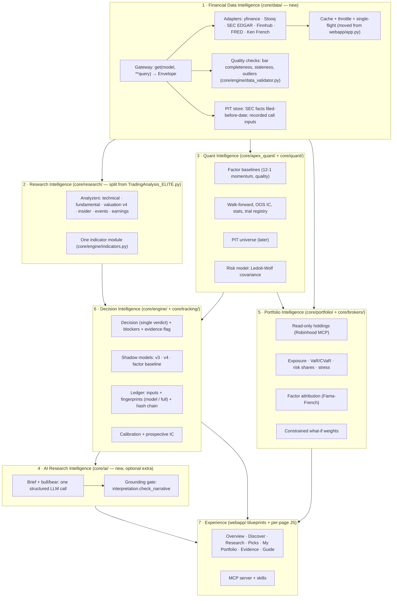

# 07 — Target architecture

## 1. Principles

1. **Keep the stack.** Flask on loopback, vanilla JS, Python engines, SQLite and files on disk.
   QUANTA is a single-user local tool; no microservices, queues, containers or hosted databases.
2. **Keep the decision core as the spine.** `core/engine/decision.py` and its blockers,
   thresholds and evidence flags stay the only place a verdict is made.
3. **LLMs explain; they never decide.** Any generated text is downstream of a `Decision`, cites it,
   and is machine-checked before display.
4. **Evidence before sophistication.** A new model ships only as a pre-registered shadow until its
   prospective test passes.
5. **Migrate, don't rewrite.** Every structural change is guarded by the golden master and the
   existing 3,858 unit tests.

## 2. Layers



### 2.1 Financial Data Intelligence (`core/data/`)

```python
# Shape only; illustrative, not implemented.
@dataclass(frozen=True)
class Envelope(Generic[T]):
    data: T
    provider: str                 # "yfinance" | "stooq" | "sec-edgar" | ...
    as_of: date | datetime | None # market time of the data itself
    retrieved_at: datetime
    from_cache: bool
    stale: bool                   # served past TTL under stale-grace
    warnings: list[str]

MODELS = ("PriceBars", "Quote", "Profile", "FinancialFacts", "Filing",
          "AnalystConsensus", "NewsItem", "MacroSeries", "FactorReturns")

FALLBACK = {"PriceBars": ["yfinance", "stooq"], "FinancialFacts": ["sec-edgar", "yfinance"], ...}
```

- Pattern from OpenBB's `Fetcher` (query → extract → transform), but **with ordered fallback**,
  which OpenBB lacks.
- The existing token bucket, single-flight and stale-grace logic in `webapp/app.py:315-357`
  moves here so engines, the CLI and the MCP server share it.
- Every `Envelope` becomes a `SourceRef` on the Decision (the field already exists).
- Migration: wrap first (adapters call the existing code), then move engines one at a time,
  golden master unchanged at each step.

**Build vs integrate vs reuse:** build (small, ~1-2K lines). Do not depend on `openbb`: heavy,
and the vendors QUANTA uses are not in its monorepo at this commit.

### 2.2 Research Intelligence (`core/research/`)

Extract the analyzer classes from `TradingAnalysis_ELITE.py` (lines 2079-7598) into modules;
keep `QuantaEliteAnalyzer` as a thin orchestrator. Indicators come from one module. No new
research methods are needed for parity; the value is maintainability and a narrower model
fingerprint.

### 2.3 Quant Intelligence

Keep `apex_quant` as is (its inference is the strongest of the four). Add, in order: factor-baseline
shadow, Ledoit-Wolf, top-k dropout evaluation, PIT universe, live-path replay. ML only after the PIT
universe, and only via the trial registry and the deflated-Sharpe/FDR gates already in `stats.py`.

### 2.4 AI Research Intelligence (`core/ai/`, optional extra `quanta[ai]`)

```
Decision.to_dict() ─┐
interpretation      ├─► one LLM call (structured output) ─► {brief[], bull[], bear[]}
SourceRef ids      ─┘        each sentence: {text, cites: [field paths | source ids]}
                                             │
                     check_narrative(text, decision) + every cite resolves
                                             │
                          pass → cache by (ticker, as_of, model_fingerprint) → UI / MCP
                          fail → show build_interpretation sentences only
```

- **Model:** a Claude model through the Anthropic SDK, behind an env flag, off by default; the key
  in `.env`, redacted by `core/brokers/redact.py`'s filter.
- **Cost control:** one call per (ticker, as_of, fingerprint), cached on disk; static instructions
  placed first for prompt caching; no tool use (QUANTA already fetched the data).
- **Not adopted from TradingAgents:** parallel analyst agents, persona risk debate, LLM-decided
  ratings, LLM-written lessons feeding later decisions.

### 2.5 Portfolio Intelligence

Existing analytics stay. Add: Ledoit-Wolf covariance for vol and risk shares; Fama-French 5 +
momentum attribution with CIs; a constrained what-if (min-variance or risk parity within the
sector, position and exposure caps); historical-episode stress on today's weights. Still read-only.

### 2.6 Decision Intelligence

- Two fingerprints per ledger row: `model_fingerprint` (scoring and decision code + every imported
  `modules/` file + evidence registry) and `code_fingerprint` (today's full-source hash, kept for audit).
  Pre-registered tests read `model_fingerprint`.
- Ledger rows carry every input the call used (A4), so later replays and calibration are possible.
- Shadows: v3, v4, factor baseline. Calibration and prospective IC on the Evidence page.

### 2.7 Experience

Flask blueprints per page (pattern already used by `portfolio_routes.py`, `plan_routes.py`,
`my_list.py`, `events_routes.py`). Per-page JS bundles loaded on navigation. New panels: Research
brief, evidence clock, factor exposure, calibration.

## 3. Decisions

| Decision | Choice | Rejected alternative | Reason |
|---|---|---|---|
| Data platform | Own thin gateway | Adopt OpenBB SDK | Size, dependency weight, missing vendors, no failover |
| Agent framework | One structured LLM call | LangGraph multi-agent | QUANTA already has the facts; 17+ calls per ticker for prose is cost without measured benefit |
| Who decides | Deterministic engine | LLM committee | PRODUCT.md principle 1; reproducibility; testability |
| ML | After PIT universe, gated | LightGBM now | No valid universe to train on; free factors not yet beaten |
| Experiment tracking | Existing trials + registry + fingerprints | MLflow | Enough for one owner; no server |
| Storage | SQLite + CSV/JSONL ledger | Postgres | Single user, loopback |
| Front end | Vanilla JS, split per page | React rewrite | 882 tests and a working design system; rewrite risk with no user benefit |
